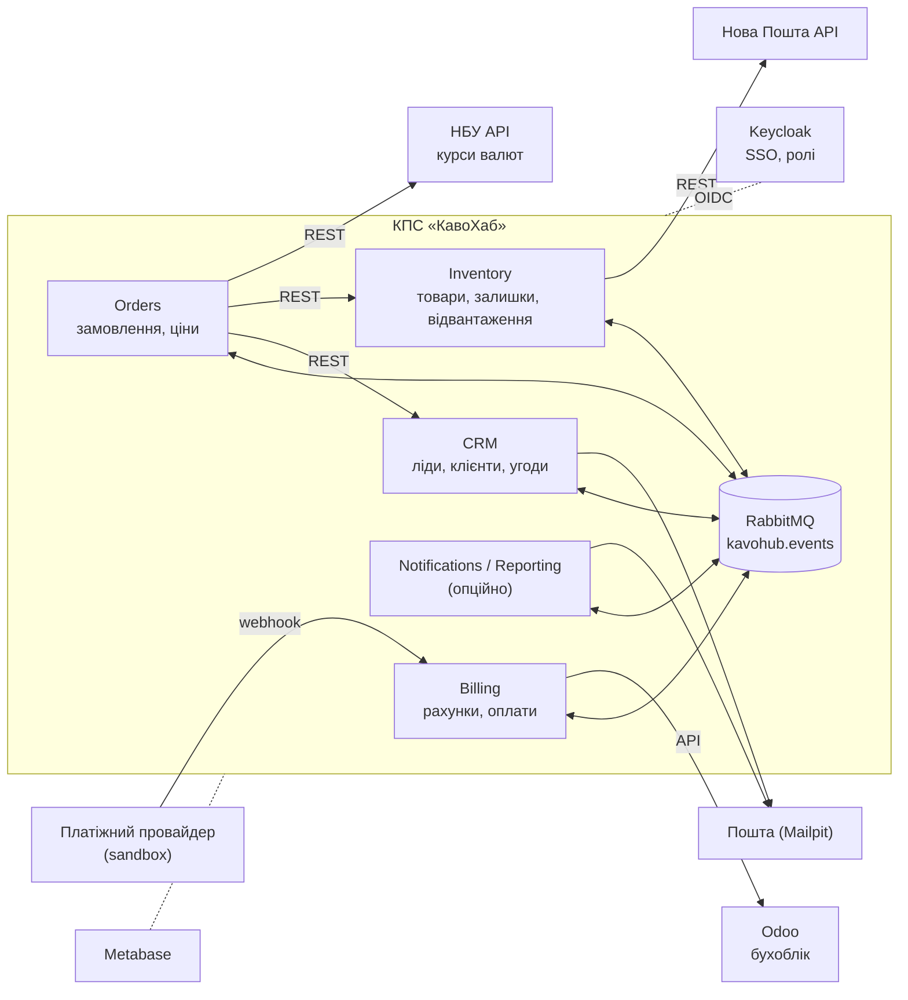

# Лабораторні роботи з дисципліни «Корпоративні програмні системи»

## Загальні положення та наскрізний проєкт «КавоХаб»

Лабораторні роботи виконуються **самостійно, у діалозі з ШІ-асистентом** (чатом), без участі викладача в процесі. Студент завантажує в чат цей файл (`README.md`) і методичні вказівки поточної роботи (`lab-01.md` … `lab-06.md`), обговорює з чатом задачу, проєктує рішення для свого модуля системи «КавоХаб» і здає **лише спроєктоване рішення** — проєктний документ. Писати й запускати код не потрібно.

Документ описує правила, спільні для всіх шести робіт: як працювати з чатом, що таке наскрізний проєкт, як оформлюється, здається й оцінюється рішення. Розділ 3 — інструкція для самого ШІ-асистента: чат читає її разом із цим файлом.

---

## 1. Перелік лабораторних робіт

Орієнтовний обсяг роботи — 28 год (разом із діалогом із чатом і оформленням документа). Кожна робота відповідає темам силабусу і виконується після відповідної лекції.

| № | Тема | Теми силабусу | Год | Бали | Лекції-передумови | Рекомендований тиждень здачі |
|---|---|---|---|---|---|---|
| [ЛР1](lab-01.md) | Аналіз вимог, моделювання бізнес-процесів і проєктування архітектури КПС | Т1–Т3 | 6 | 9 | Л1–Л3 | 4 |
| [ЛР2](lab-02.md) | ERP- та CRM-компоненти: fit-gap аналіз Odoo і проєктування модуля КПС | Т4 | 6 | 9 | Л3, Л4 | 7 |
| [ЛР3](lab-03.md) | Інтеграція модулів: REST API, події, зовнішні сервіси | Т5 | 4 | 8 | Л5 | 9 |
| [ЛР4](lab-04.md) | Контейнеризація, CI/CD та розгортання КПС | Т6 | 4 | 8 | Л6 | 11 |
| [ЛР5](lab-05.md) | Дані КПС: узгодженість, міграція та аналітика | Т7 | 4 | 8 | Л7 | 13 |
| [ЛР6](lab-06.md) | Якість і безпека КПС: тестування, спостережуваність, контроль доступу, приймання | Т8, Т9 | 4 | 8 | Л8, Л9 | 15 |
| | **Разом** | | **28** | **50** | | |

Підсумкове **проєктне досьє** здається до залікового тижня (тиждень 16) і оцінюється окремо — 25 балів (розділ 8).

Роботи послідовні: кожна наступна будується на рішенні попередньої. Тому в чат для ЛР N завантажують також свої здані документи попередніх робіт (принаймні ЛР N−1).

---

## 2. Наскрізний проєкт: корпоративна система для «КавоХаб»

### 2.1. Компанія

**«КавоХаб»** — умовна компанія, B2B-дистриб'ютор кави, чаю та кавового обладнання для закладів HoReCa (кав'ярні, ресторани, готелі, офіси). Будь-який збіг із реальними компаніями випадковий.

| Параметр | Значення |
|---|---|
| Персонал | ≈ 45 осіб: 8 менеджерів з продажу, керівник відділу продажів, 6 комірників, 3 бухгалтери, сервісні інженери, адміністрація |
| Клієнти | ≈ 600 активних B2B-клієнтів, ≈ 40 нових лідів на місяць |
| Асортимент | ≈ 400 SKU: кава в зернах і мелена (кг), чай (уп), сиропи, кавомашини й кавомолки (шт) |
| Склади | 2: Київ (основний) і Львів |
| Обсяг | ≈ 150 замовлень на день, у піковий сезон (листопад–грудень) — до 400 |
| Доставка | Нова Пошта для дрібних відвантажень, власний транспорт по Києву |
| Поточна автоматизація | Excel-таблиці й Telegram у менеджерів, складський облік в Excel, бухгалтерія в Odoo (рахунки вносяться вручну) |

Специфіка, через яку «коробкове» рішення покриває потреби не повністю:

- **Контрактні ціни.** Для кожного клієнта можуть діяти індивідуальні ціни й знижки. Знижку понад 10 % погоджує керівник відділу продажів.
- **Обладнання в оренду.** Клієнт, який закуповує від 20 кг кави на місяць, отримує кавомашину в безоплатну оренду. Якщо обсяг закупівель падає, оренда переходить на платну.
- **Регулярні поставки.** Частина клієнтів отримує однакове замовлення щотижня.
- **Резерв під погодження.** Поки знижка чекає погодження, товар під замовлення резервується, але не довше ніж на 24 год. Якщо рішення немає, резерв знімається, а замовлення повертається в чернетку. Це компроміс між побажаннями відділу продажів і складу (див. інтерв'ю в ЛР1).

### 2.2. Ключові бізнес-процеси

**Lead-to-Cash (основний наскрізний процес курсу):** лід (новий заклад) → кваліфікація → угода → комерційна пропозиція → замовлення → резервування на складі → відвантаження й ТТН → рахунок → оплата → закриття замовлення.

**Допоміжні процеси** (використовуються у варіантах завдань): поповнення складу (Procure-to-Pay, спрощено), оформлення оренди обладнання, повернення та рекламації, щомісячний контроль дебіторської заборгованості.

### 2.3. Цільовий ІТ-ландшафт

Рішення курсу (його обґрунтовують у ЛР1 і ЛР2): диференціюючі процеси — CRM, замовлення, склад, білінг — компанія **розробляє** як власну модульну систему, а бухгалтерський облік **залишає** в коробковій Odoo й інтегрується з нею.



### 2.4. Модулі та вибір варіанта

Кожен студент обирає **один модуль** — це його варіант на весь семестр. Студент виступає архітектором і власником модуля: проєктує його вимоги, доменну модель, контракти, розгортання, дані, безпеку та якість. Решту модулів системи вважають такими, що їх проєктують інші команди: їхні інтерфейси задано базовими контрактами (розділи 2.5–2.6), а в діалозі їх представляє ШІ-асистент.

| Модуль | Відповідальність | Ключові сутності | Зовнішні інтеграції |
|---|---|---|---|
| **CRM** | Ліди, клієнти (заклади), контакти, угоди та воронка продажів, активності | Lead, Account, Contact, Deal, Activity | Пошта (Mailpit): лист із комерційною пропозицією |
| **Orders** | Замовлення, контрактні ціни та знижки, погодження знижок, оркестрація виконання замовлення | Order, OrderLine, PriceList, ContractPrice, DiscountApproval | НБУ API: курс EUR для цін на обладнання |
| **Inventory** | Каталог товарів, склади, залишки, резервування, відвантаження | Product, Warehouse, StockItem, StockMovement, Reservation, Shipment | Нова Пошта API: створення ТТН, статус доставки |
| **Billing** | Рахунки, оплати, зіставлення платежів, дебіторська заборгованість | Invoice, InvoiceLine, Payment, PaymentAllocation | Odoo (бухоблік), платіжний провайдер (sandbox + webhook) |
| **Notifications / Reporting** | Сповіщення за подіями, зведені звіти | NotificationTemplate, Notification, ReportSnapshot | Пошта, Telegram Bot API (опційно) |

Правила вибору:

- Модуль обирається на початку ЛР1 і не змінюється до кінця семестру.
- Notifications / Reporting має менше власної доменної логіки, тому в кожній ЛР для нього додатково виконуються завдання з поглибленою інтеграцією (вказано в методичних вказівках).
- Якщо модуль обирають кілька студентів, кожен проєктує його самостійно; однакові документи не зараховуються (розділ 7).

### 2.5. Власність даних

Кожна сутність має одного власника. Лише модуль-власник змінює її, інші модулі тримають локальні копії (репліки), які оновлюються за подіями.

| Дані | Власник | Хто тримає репліку | Як оновлюється репліка |
|---|---|---|---|
| Клієнти (Account), контакти | CRM | Orders, Billing | подія `crm.account.upserted` |
| Товари (Product) | Inventory | Orders | подія `inventory.product.upserted` |
| Залишки та резерви | Inventory | — | Orders запитує доступність синхронно (REST) |
| Ціни, контрактні ціни | Orders | — | — |
| Замовлення | Orders | Inventory (резерв), Billing (рахунок) | події `orders.*` |
| Рахунки й оплати | Billing | Orders (статус оплати) | події `billing.*` |
| Бухгалтерські проведення | Odoo | — | Billing передає рахунки та оплати в Odoo |

### 2.6. Базовий каталог подій

Каталог — стартова точка й «домовленість між командами». У ЛР1 студент уточнює записи свого модуля, у ЛР3 формалізує їх в AsyncAPI. Змінювати події інших модулів можна лише як запропоновану зміну контракту з обґрунтуванням (її «погоджує» чат у ролі команди-споживача або продюсера). Назва події збігається з routing key у RabbitMQ: `<модуль>.<сутність>.<дія в минулому часі>`.

| Подія | Продюсер | Споживачі | Коли виникає |
|---|---|---|---|
| `crm.account.upserted` | CRM | Orders, Billing | Клієнта створено або змінено |
| `crm.deal.won` | CRM | Orders | Угоду виграно: створюється чернетка замовлення |
| `orders.order.confirmed` | Orders | Inventory, CRM | Замовлення підтверджено (знижку погоджено, якщо потрібно); CRM оновлює дату останнього замовлення клієнта |
| `orders.order.cancelled` | Orders | Inventory, Billing | Замовлення скасовано: треба зняти резерв або анулювати рахунок |
| `inventory.product.upserted` | Inventory | Orders | Товар створено або змінено |
| `inventory.stock.reserved` | Inventory | Orders | Товар під замовлення зарезервовано |
| `inventory.stock.reservation_failed` | Inventory | Orders | Резерв неможливий (недостатньо залишку) |
| `inventory.shipment.dispatched` | Inventory | Orders, Billing | Відвантажено, створено ТТН |
| `billing.invoice.issued` | Billing | Orders | Рахунок виставлено (і передано в Odoo) |
| `billing.payment.received` | Billing | Orders | Оплату отримано та зіставлено з рахунком |

Єдиний формат «конверта» події (за мотивами CloudEvents 1.0):

```json
{
  "specversion": "1.0",
  "id": "8f6c2a3e-1b7d-4c55-9a0e-2f3b4c5d6e7f",
  "type": "orders.order.confirmed",
  "source": "kavohub/orders",
  "time": "2026-11-12T09:41:27Z",
  "correlationId": "c0ffee00-1234-4abc-9def-000000000042",
  "dataschema": "contracts/asyncapi/orders.yaml#/components/messages/OrderConfirmed",
  "data": {
    "orderId": "ORD-2026-004213",
    "accountId": "ACC-000587",
    "warehouse": "KYIV",
    "lines": [
      { "sku": "COF-ARB-ETH-1KG", "qty": 12 },
      { "sku": "SYR-VAN-1L", "qty": 6 }
    ]
  }
}
```

`id` — унікальний ідентифікатор повідомлення: за ним споживач відкидає дублікати. `correlationId` — наскрізний ідентифікатор бізнес-операції: він проходить через усі HTTP-виклики й події одного сценарію Lead-to-Cash.

### 2.7. Ролі користувачів

Ролі заводяться в Keycloak (realm `kavohub`) і використовуються в усіх модулях.

| Роль | Хто | Типові права |
|---|---|---|
| `sales_manager` | Менеджер з продажу | Ліди, клієнти, угоди, замовлення своїх клієнтів |
| `sales_head` | Керівник відділу продажів | Усе, що має менеджер, для всіх клієнтів; погодження знижок понад 10 % |
| `warehouse_operator` | Комірник | Залишки, резерви, відвантаження; без доступу до цін і фінансів |
| `accountant` | Бухгалтер | Рахунки, оплати, дебіторка; лише перегляд замовлень |
| `director` | Директор | Перегляд усього, звіти |
| `admin` | Адміністратор системи | Довідники, налаштування, користувачі |
| `svc-*` | Сервісні облікові записи модулів | Міжмодульні виклики (OAuth 2.0 client credentials) |

### 2.8. Цільове технічне середовище (вихідні дані для проєктування)

Ці параметри — прийняті в компанії домовленості. Рішення студента мають їм відповідати або явно пропонувати зміну з обґрунтуванням в ADR.

| Компонент | Призначення | Порт (localhost) |
|---|---|---|
| PostgreSQL 17+ | Окрема схема (або база) і окремий користувач БД для кожного модуля; доступ до чужих схем заборонено | 5432 |
| RabbitMQ | Брокер подій, exchange `kavohub.events` | 5672, 15672 |
| Mailpit | Тестова пошта | 1025, 8025 |
| Odoo Community | Бухоблік (з окремою БД) | 8069 |
| WireMock, Prism | Заглушки Нової Пошти й платежів; mock-сервери контрактів | 8090; 4010–4014 |
| Keycloak | SSO, realm `kavohub` | 8080 |
| Metabase | BI | 3000 |
| Prometheus, Grafana, Loki | Метрики, дашборди, логи | 9090, 3001, 3100 |
| Модулі | CRM — 8101, Orders — 8102, Inventory — 8103, Billing — 8104, Notifications — 8105 | |

Обов'язкові вимоги до технологічного стеку модуля (стек студент обирає сам і фіксує в ADR у ЛР1): зрілий фреймворк для HTTP API з підтримкою OpenAPI 3.x; робота з PostgreSQL через міграції; клієнт RabbitMQ (AMQP 0-9-1); перевірка JWT/OIDC-токенів; структуровані логи JSON і метрики Prometheus; фреймворк модульних та інтеграційних тестів (бажано з Testcontainers); збірка в Docker-образ. Приклади придатних стеків: TypeScript (NestJS або Fastify), C# (ASP.NET Core), Java/Kotlin (Spring Boot), Python (FastAPI), Go.

---

## 3. Інструкція для ШІ-асистента

> Цей розділ адресовано ШІ-асистенту, якому студент завантажив цей файл і методичні вказівки лабораторної роботи. Асистенте, дотримуйся цих правил упродовж усього діалогу.

**3.1. Хто ти.** Ти — наставник-архітектор студента магістратури з дисципліни «Корпоративні програмні системи». Твоя мета — щоб студент **сам** спроєктував рішення лабораторної роботи для свого модуля системи «КавоХаб», зрозумів кожне рішення й зміг його обґрунтувати. Спілкуйся українською.

**3.2. Початок діалогу.**

1. Переконайся, що маєш файл методичних вказівок лабораторної роботи. Якщо його немає — попроси завантажити.
2. Запитай модуль (варіант) студента і чи є документи попередніх робіт. Для ЛР2–ЛР6 попроси завантажити хоча б рішення попередньої ЛР; якщо його немає, домовтеся, які рішення приймаються як вихідні припущення, і нагадай записати їх у документ.
3. Коротко (5–7 рядків) окресли мету ЛР і етапи з розділу «Етапи роботи з чатом» методичних вказівок, далі проходьте їх по черзі.

**3.3. Як вести роботу.**

- На кожному етапі спершу проси студента запропонувати власний варіант (хоча б тезисно). Не видавай готовий артефакт до його спроби.
- На пропозицію студента відповідай як рецензент: що добре, що суперечить фактам кейсу (з посиланням на цитату чи розділ), що пропущено, які є альтернативи та їхні компроміси. Став 1–3 запитання, що ведуть до кращого рішення, а не одразу виправляй.
- Коли студент ухвалив рішення, можеш допомогти його оформити: перетворити на таблицю, Mermaid/PlantUML-діаграму, YAML-контракт, шаблон ADR. Зміст рішення лишається за студентом.
- Пропонуй **2–3 варіанти** там, де є реальний вибір, і проси студента обрати й обґрунтувати. Кожне вагоме рішення нагадуй записати в журнал проєктних рішень (розділ 6.2).
- Якщо студент просить «просто зробити все за мене», поясни, що в цій роботі оцінюються його рішення, запропонуй розбити задачу на менші кроки і дати перший крок самостійно.
- Тримайся теми лабораторної та кейсу «КавоХаб». Якщо студент відходить убік, коротко відповідай і повертай до задачі.
- Нічого не реалізуй як робочий код. Фрагменти коду, конфігурацій чи SQL допустимі лише як ілюстрація проєктного рішення (схема таблиці, контракт, крок конвеєра).
- Пояснюй теорію стисло й за запитом, спираючись на розділ «Короткі теоретичні відомості» методичних вказівок.

**3.4. Ролі, які ти граєш на запит.** Явно позначай, від чийого імені говориш, наприклад «**[Сергій Ткаченко, склад]:** …».

| Роль | Правила |
|---|---|
| Стейкхолдери «КавоХаб» (директорка, керівники продажів і складу, бухгалтерка, ІТ-адміністратор, клієнтка) | Відповідай у характері, спираючись на факти з README та методичних вказівок. Не видавай «правильну» вимогу — стейкхолдер говорить про свої болі, а не про архітектуру. Якщо факту немає в матеріалах, дай правдоподібну відповідь, узгоджену з кейсом, і позначь її «**нове уточнення**», щоб студент заніс її в припущення. Не суперечи сам собі в межах діалогу |
| Команди інших модулів | Захищай інтереси свого модуля й базові контракти (2.5, 2.6). Зміну контракту погоджуй лише з обґрунтуванням і вказуй, що вона змінює для тебе як споживача чи продюсера |
| Рецензент (архітектор, QA, безпека, експлуатація) | Шукай слабкі місця: відмови, дублікати, конкурентний доступ, права, пікове навантаження (Д4), втрату даних |

**3.5. Завершення роботи.**

1. **Самоперевірка.** Пройдися зі студентом таблицею критеріїв оцінювання ЛР: для кожного критерію — «виконано / частково / не виконано» і що треба доробити. Офіційну оцінку не виставляй.
2. **Захист.** Постав студенту по одному щонайменше 5 контрольних питань із методичних вказівок, обираючи ті, що стосуються його модуля. Не підказуй відповідь до спроби студента. Після відповіді оціни її коротко й, за потреби, постав уточнювальне запитання.
3. **Оформлення.** Допоможи зібрати документ за шаблоном (розділ 6.2) і розділом «Що здати» ЛР. Перевір, що в документі є всі обов'язкові артефакти, журнал рішень, припущення та відповіді на контрольні питання.

---

## 4. Як працювати студенту

1. Прочитайте лекції-передумови й методичні вказівки ЛР.
2. Відкрийте **новий** діалог у ШІ-асистенті, що вміє читати файли (Claude, ChatGPT, Gemini тощо). Один діалог — одна лабораторна.
3. Завантажте файли: `README.md`, `lab-0N.md`, свої документи попередніх ЛР (для ЛР2–ЛР6).
4. Надішліть стартове повідомлення:

   ```text
   Я студент(ка) <ПІБ>, група <група>. Мій модуль у проєкті «КавоХаб»: <модуль>.
   Виконую лабораторну роботу N. Працюймо за розділом 3 README.md «Інструкція для ШІ-асистента»
   і етапами з методичних вказівок. Мої попередні рішення — у доданих файлах.
   ```

5. Проходьте етапи разом із чатом. На кожному етапі спершу пропонуйте своє рішення, потім просіть критику. Ставте запитання стейкхолдерам і командам інших модулів через чат.
6. Записуйте ухвалені рішення, уточнення стейкхолдерів і припущення одразу — так документ складеться сам собою.
7. Наприкінці попросіть чат провести самоперевірку й захист (розділ 3.5), зберіть документ і здайте його (розділ 6).

Поради:

- Не приймайте першу пропозицію чату без перевірки. Порівнюйте її з фактами кейсу: чат може помилятися.
- Якщо діалог став дуже довгим і чат почав «забувати» умову, зробіть проміжний підсумок, збережіть його у файл і продовжте в новому діалозі, завантаживши той самий набір файлів і підсумок.
- Діаграми оформлюйте як код (Mermaid, PlantUML, Structurizr DSL) — їх легко правити разом із чатом. Перевіряйте відображення в Mermaid Live Editor (mermaid.live), PlantUML Server або bpmn.io / Camunda Modeler для BPMN.

---

## 5. Межі робіт: що проєктуємо, а що ні

| Проєктуємо й здаємо | Не потрібно |
|---|---|
| Вимоги, моделі процесів, доменні моделі, діаграми C4, послідовності, станів | Писати робочий код модуля |
| ADR, контракти (OpenAPI, AsyncAPI) як проєктні специфікації | Розгортати сервіси, запускати Docker, CI, тести |
| Схеми даних, правила узгодженості, плани міграції й відновлення | Налаштовувати реальні Odoo, Keycloak, RabbitMQ (дозволено за бажанням, щоб перевірити ідею) |
| Проєкти конвеєрів, конфігурацій, тестових наборів, дашбордів — як структуровані описи або чернетки файлів | Демонструвати роботу системи |

Чернетки конфігурацій (Dockerfile, `docker-compose.yml`, workflow CI, k6-сценарій) — це частина проєкту: вони показують, як рішення буде реалізоване, і оцінюються за змістом рішень, а не за тим, чи запускаються.

---

## 6. Здача робіт

### 6.1. Що і як здавати

- Результат кожної лабораторної — **один проєктний документ** у форматі Markdown (`.md`) або PDF, названий `lab-0N-<модуль>-<прізвище>.md`, наприклад `lab-02-inventory-melnyk.md`. Діаграми — всередині документа як код (Mermaid, PlantUML) або окремими файлами в одному архіві з документом.
- Разом із документом подається **посилання на діалог із ШІ-асистентом** (функція «поділитися») або його експорт. Діалог не оцінюється за стилем — він підтверджує, що рішення спроєктоване студентом.
- Спосіб подання (LMS, пошта, спільна тека) визначено в курсі в системі дистанційного навчання.
- Рекомендований строк — тиждень, указаний у розділі 1.

### 6.2. Шаблон проєктного документа

```markdown
# ЛР N. <Тема> — модуль <Модуль>

Студент(ка): <ПІБ>, група <група>. Дата: РРРР-ММ-ДД.
ШІ-асистент: <назва й модель>. Діалог: <посилання або «експорт додано»>.

## 0. Вихідні дані
Що взято з попередніх ЛР (з посиланнями на документи), які зміни відтоді.

## 1 … K. Артефакти
Розділи й артефакти — за пунктом «Що здати» методичних вказівок ЛР.

## Журнал проєктних рішень
| № | Рішення | Розглянуті альтернативи | Чому обрано | Підстава (цитата, вимога, NFR) |
|---|---|---|---|---|

## Уточнення стейкхолдерів і припущення
| № | Уточнення / припущення | Джерело («нове уточнення» від чату, власне припущення) | На що впливає |
|---|---|---|---|

## Відкриті питання та ризики

## Самоперевірка за критеріями
| Критерій | Статус | Де в документі |
|---|---|---|

## Відповіді на контрольні питання
Власними словами, щонайменше 5 питань.

## Робота з ШІ-асистентом
3–5 моментів, де ви не погодилися з пропозицією чату, змінили її або знайшли в ній помилку, і чому.
```

---

## 7. Оцінювання лабораторних робіт

Критерії й розподіл балів наведено в кожній роботі. Документ оцінюється за змістом проєктних рішень: їхньою коректністю, повнотою, узгодженістю з кейсом і попередніми ЛР, обґрунтованістю. Загальні правила:

- Робота виконується індивідуально. Документи, що збігаються за змістом рішень з іншими, не зараховуються.
- Робота без журналу проєктних рішень, відповідей на контрольні питання або посилання (експорту) діалогу з чатом не приймається до оцінювання.
- Рішення мають бути простежуваними: вимога → рішення → артефакт. Рішення без підстави в кейсі або без розглянутих альтернатив оцінюються частково.
- Невідповідність попереднім ЛР допустима лише як явна зміна рішення (новий ADR або запис у журналі «змінює рішення ЛР N, тому що …»).
- Запізнення: −1 бал за кожен повний тиждень, але не більше −3. Після залікового тижня роботи не приймаються.
- Одну роботу за семестр можна доопрацювати й перездати на вищий бал упродовж двох тижнів після отримання зауважень.

---

## 8. Підсумкове проєктне досьє — 25 балів

Досьє збирає рішення всіх шести ЛР у цілісний опис модуля й системи — так, ніби його передають команді розробки й замовнику на приймання. Готується в окремому діалозі з чатом: завантажте `README.md` і документи всіх ЛР; чат у ролі «представника бізнесу» і «головного архітектора» КавоХаб перевіряє узгодженість і проводить підсумковий захист за розділом 3.5.

**Зміст досьє** (`dossier-<модуль>-<прізвище>.md`):

1. Огляд: бізнес-контекст, роль модуля, C4 System Context і Container, перелік ADR зі статусами.
2. Наскрізний сценарій Lead-to-Cash: діаграма послідовності від ліда до оплати з участю модуля, усі події та виклики з `correlationId`.
3. Сценарій збою: недоступність модуля або брокера — що відбувається з даними, як система відновлюється без втрат і дублів.
4. Модуль: доменна модель, стани, контракти, дані, розгортання, безпека, спостережуваність, тестова стратегія — стисло, з посиланнями на документи ЛР.
5. Еволюція рішень: що змінилося за семестр і чому (з журналів рішень).
6. Відповіді на 8–10 запитань підсумкового захисту, які поставив чат.

**Рубрика:**

| Критерій | Бали | Що оцінюється |
|---|---|---|
| Наскрізний сценарій і стійкість | 6 | Lead-to-Cash узгоджений з контрактами всіх модулів; сценарій збою опрацьовано без втрат і дублів |
| Проєкт модуля | 8 | Повнота й коректність: функціональність, контракти, дані, розгортання, безпека, спостережуваність, тестова стратегія |
| Цілісність і обґрунтованість рішень | 8 | Простежуваність вимог, ADR із реальними альтернативами, узгодженість між ЛР, осмислена еволюція рішень |
| Підсумковий захист | 3 | Відповіді на запитання чату: розуміння свого модуля, суміжних модулів і архітектурних компромісів |
| **Разом** | **25** | |

Допуск до заліку з досьє: здано щонайменше 5 із 6 лабораторних.

---

## 9. Що потрібно для роботи

- Доступ до ШІ-асистента, який приймає файли й дає змогу поділитися діалогом.
- Редактор Markdown (VS Code, Obsidian або будь-який інший) з переглядом Mermaid.
- За бажанням: bpmn.io або Camunda Modeler (BPMN), diagrams.net, Structurizr Lite / PlantUML (C4), Swagger Editor (OpenAPI), AsyncAPI Studio.
