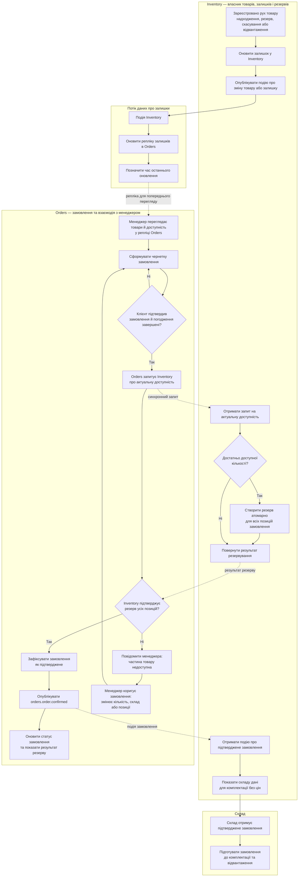
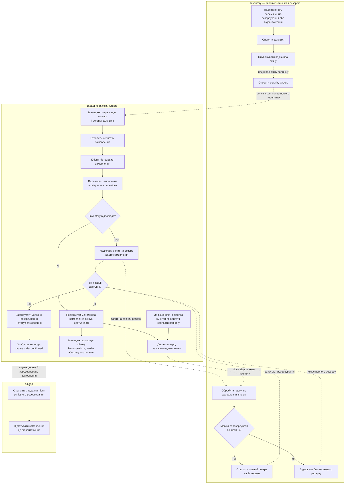

# Проаналізуй README та lab-01

> [@GitHub](plugin://github@openai-curated-remote) [https://github.com/OleksandrLysenkoKPI/corporate-software-systems-lessons](https://github.com/OleksandrLysenkoKPI/corporate-software-systems-lessons)\
> Це мій GitHub репозиторій, але івн вже клонований за даним шляхом C:/Users/lysen/.codex/.chatgpt-projects/g-p-6ae260eb15a881919773da222ec79b70/corporate-software-systems-lessons/
>
> Проаналізуй файл README.md та lab-01.md

<details><summary>2 previous messages</summary>

> Спершу перевірю локальні версії `README.md` і `lab-01.md`, а також відкрию репозиторій через GitHub, щоб звірити контекст. Потім підсумую призначення, структуру, вимоги й можливі неузгодженості.
>
> <details><summary>Ran a command, called 2 tools</summary>
>
> - Ran `Get-Content -Raw README.md; Get-Content -Raw lab-01.md`
>
> MCP tool call
>
> codex_apps.github.fetch_file
>
> ```json
> {
>   "repository_full_name": "OleksandrLysenkoKPI/corporate-software-systems-lessons",
>   "path": "README.md"
> }
> ```
>
> ```text
> Action completed.
> ```
>
> ````json
> {
>   "content": "# Лабораторні роботи з дисципліни «Корпоративні програмні системи»\n\n## Загальні положення та наскрізний проєкт «КавоХаб»\n\nЛабораторні роботи виконуються **самостійно, у діалозі з ШІ-асистентом** (чатом), без участі викладача в процесі. Студент завантажує в чат цей файл (`README.md`) і методичні вказівки поточної роботи (`lab-01.md` … `lab-06.md`), обговорює з чатом задачу, проєктує рішення для свого модуля системи «КавоХаб» і здає **лише спроєктоване рішення** — проєктний документ. Писати й запускати код не потрібно.\n\nДокумент описує правила, спільні для всіх шести робіт: як працювати з чатом, що таке наскрізний проєкт, як оформлюється, здається й оцінюється рішення. Розділ 3 — інструкція для самого ШІ-асистента: чат читає її разом із цим файлом.\n\n---\n\n## 1. Перелік лабораторних робіт\n\nОрієнтовний обсяг роботи — 28 год (разом із діалогом із чатом і оформленням документа). Кожна робота відповідає темам силабусу і виконується після відповідної лекції.\n\n| № | Тема | Теми силабусу | Год | Бали | Лекції-передумови | Рекомендований тиждень здачі |\n|---|---|---|---|---|---|---|\n| [ЛР1](lab-01.md) | Аналіз вимог, моделювання бізнес-процесів і проєктування архітектури КПС | Т1–Т3 | 6 | 9 | Л1–Л3 | 4 |\n| [ЛР2](lab-02.md) | ERP- та CRM-компоненти: fit-gap аналіз Odoo і проєктування модуля КПС | Т4 | 6 | 9 | Л3, Л4 | 7 |\n| [ЛР3](lab-03.md) | Інтеграція модулів: REST API, події, зовнішні сервіси | Т5 | 4 | 8 | Л5 | 9 |\n| [ЛР4](lab-04.md) | Контейнеризація, CI/CD та розгортання КПС | Т6 | 4 | 8 | Л6 | 11 |\n| [ЛР5](lab-05.md) | Дані КПС: узгодженість, міграція та аналітика | Т7 | 4 | 8 | Л7 | 13 |\n| [ЛР6](lab-06.md) | Якість і безпека КПС: тестування, спостережуваність, контроль доступу, приймання | Т8, Т9 | 4 | 8 | Л8, Л9 | 15 |\n| | **Разом** | | **28** | **50** | | |\n\nПідсумкове **проєктне досьє** здається до залікового тижня (тиждень 16) і оцінюється окремо — 25 балів (розділ 8).\n\nРоботи послідовні: кожна наступна будується на рішенні попередньої. Тому в чат для ЛР N завантажують також свої здані документи попередніх робіт (принаймні ЛР N−1).\n\n---\n\n## 2. Наскрізний проєкт: корпоративна система для «КавоХаб»\n\n### 2.1. Компанія\n\n**«КавоХаб»** — умовна компанія, B2B-дистриб'ютор кави, чаю та кавового обладнання для закладів HoReCa (кав'ярні, ресторани, готелі, офіси). Будь-який збіг із реальними компаніями випадковий.\n\n| Параметр | Значення |\n|---|---|\n| Персонал | ≈ 45 осіб: 8 менеджерів з продажу, керівник відділу продажів, 6 комірників, 3 бухгалтери, сервісні інженери, адміністрація |\n| Клієнти | ≈ 600 активних B2B-клієнтів, ≈ 40 нових лідів на місяць |\n| Асортимент | ≈ 400 SKU: кава в зернах і мелена (кг), чай (уп), сиропи, кавомашини й кавомолки (шт) |\n| Склади | 2: Київ (основний) і Львів |\n| Обсяг | ≈ 150 замовлень на день, у піковий сезон (листопад–грудень) — до 400 |\n| Доставка | Нова Пошта для дрібних відвантажень, власний транспорт по Києву |\n| Поточна автоматизація | Excel-таблиці й Telegram у менеджерів, складський облік в Excel, бухгалтерія в Odoo (рахунки вносяться вручну) |\n\nСпецифіка, через яку «коробкове» рішення покриває потреби не повністю:\n\n- **Контрактні ціни.** Для кожного клієнта можуть діяти індивідуальні ціни й знижки. Знижку понад 10 % погоджує керівник відділу продажів.\n- **Обладнання в оренду.** Клієнт, який закуповує від 20 кг кави на місяць, отримує кавомашину в безоплатну оренду. Якщо обсяг закупівель падає, оренда переходить на платну.\n- **Регулярні поставки.** Частина клієнтів отримує однакове замовлення щотижня.\n- **Резерв під погодження.** Поки знижка чекає погодження, товар під замовлення резервується, але не довше ніж на 24 год. Якщо рішення немає, резерв знімається, а замовлення повертається в чернетку. Це компроміс між побажаннями відділу продажів і складу (див. інтерв'ю в ЛР1).\n\n### 2.2. Ключові бізнес-процеси\n\n**Lead-to-Cash (основний наскрізний процес курсу):** лід (новий заклад) → кваліфікація → угода → комерційна пропозиція → замовлення → резервування на складі → відвантаження й ТТН → рахунок → оплата → закриття замовлення.\n\n**Допоміжні процеси** (використовуються у варіантах завдань): поповнення складу (Procure-to-Pay, спрощено), оформлення оренди обладнання, повернення та рекламації, щомісячний контроль дебіторської заборгованості.\n\n### 2.3. Цільовий ІТ-ландшафт\n\nРішення курсу (його обґрунтовують у ЛР1 і ЛР2): диференціюючі процеси — CRM, замовлення, склад, білінг — компанія **розробляє** як власну модульну систему, а бухгалтерський облік **залишає** в коробковій Odoo й інтегрується з нею.\n\n```mermaid\nflowchart LR\n  subgraph KH[\"КПС «КавоХаб»\"]\n    CRM[\"CRM<br/>ліди, клієнти, угоди\"]\n    ORD[\"Orders<br/>замовлення, ціни\"]\n    INV[\"Inventory<br/>товари, залишки, відвантаження\"]\n    BIL[\"Billing<br/>рахунки, оплати\"]\n    NTF[\"Notifications / Reporting<br/>(опційно)\"]\n    MQ[(\"RabbitMQ<br/>kavohub.events\")]\n  end\n  KC[\"Keycloak<br/>SSO, ролі\"]\n  ODOO[\"Odoo<br/>бухоблік\"]\n  NP[\"Нова Пошта API\"]\n  PAY[\"Платіжний провайдер<br/>(sandbox)\"]\n  NBU[\"НБУ API<br/>курси валют\"]\n  MAIL[\"Пошта (Mailpit)\"]\n  BI[\"Metabase\"]\n\n  CRM <--> MQ\n  ORD <--> MQ\n  INV <--> MQ\n  BIL <--> MQ\n  NTF <--> MQ\n  ORD -- REST --> CRM\n  ORD -- REST --> INV\n  ORD -- REST --> NBU\n  INV -- REST --> NP\n  BIL -- API --> ODOO\n  PAY -- webhook --> BIL\n  CRM --> MAIL\n  NTF --> MAIL\n  KH -. OIDC .- KC\n  BI -. read-only .- KH\n```\n\n### 2.4. Модулі та вибір варіанта\n\nКожен студент обирає **один модуль** — це його варіант на весь семестр. Студент виступає архітектором і власником модуля: проєктує його вимоги, доменну модель, контракти, розгортання, дані, безпеку та якість. Решту модулів системи вважають такими, що їх проєктують інші команди: їхні інтерфейси задано базовими контрактами (розділи 2.5–2.6), а в діалозі їх представляє ШІ-асистент.\n\n| Модуль | Відповідальність | Ключові сутності | Зовнішні інтеграції |\n|---|---|---|---|\n| **CRM** | Ліди, клієнти (заклади), контакти, угоди та воронка продажів, активності | Lead, Account, Contact, Deal, Activity | Пошта (Mailpit): лист із комерційною пропозицією |\n| **Orders** | Замовлення, контрактні ціни та знижки, погодження знижок, оркестрація виконання замовлення | Order, OrderLine, PriceList, ContractPrice, DiscountApproval | НБУ API: курс EUR для цін на обладнання |\n| **Inventory** | Каталог товарів, склади, залишки, резервування, відвантаження | Product, Warehouse, StockItem, StockMovement, Reservation, Shipment | Нова Пошта API: створення ТТН, статус доставки |\n| **Billing** | Рахунки, оплати, зіставлення платежів, дебіторська заборгованість | Invoice, InvoiceLine, Payment, PaymentAllocation | Odoo (бухоблік), платіжний провайдер (sandbox + webhook) |\n| **Notifications / Reporting** | Сповіщення за подіями, зведені звіти | NotificationTemplate, Notification, ReportSnapshot | Пошта, Telegram Bot API (опційно) |\n\nПравила вибору:\n\n- Модуль обирається на початку ЛР1 і не змінюється до кінця семестру.\n- Notifications / Reporting має менше власної доменної логіки, тому в кожній ЛР для нього додатково виконуються завдання з поглибленою інтеграцією (вказано в методичних вказівках).\n- Якщо модуль обирають кілька студентів, кожен проєктує його самостійно; однакові документи не зараховуються (розділ 7).\n\n### 2.5. Власність даних\n\nКожна сутність має одного власника. Лише модуль-власник змінює її, інші модулі тримають локальні копії (репліки), які оновлюються за подіями.\n\n| Дані | Власник | Хто тримає репліку | Як оновлюється репліка |\n|---|---|---|---|\n| Клієнти (Account), контакти | CRM | Orders, Billing | подія `crm.account.upserted` |\n| Товари (Product) | Inventory | Orders | подія `inventory.product.upserted` |\n| Залишки та резерви | Inventory | — | Orders запитує доступність синхронно (REST) |\n| Ціни, контрактні ціни | Orders | — | — |\n| Замовлення | Orders | Inventory (резерв), Billing (рахунок) | події `orders.*` |\n| Рахунки й оплати | Billing | Orders (статус оплати) | події `billing.*` |\n| Бухгалтерські проведення | Odoo | — | Billing передає рахунки та оплати в Odoo |\n\n### 2.6. Базовий каталог подій\n\nКаталог — стартова точка й «домовленість між командами». У ЛР1 студент уточнює записи свого модуля, у ЛР3 формалізує їх в AsyncAPI. Змінювати події інших модулів можна лише як запропоновану зміну контракту з обґрунтуванням (її «погоджує» чат у ролі команди-споживача або продюсера). Назва події збігається з routing key у RabbitMQ: `<модуль>.<сутність>.<дія в минулому часі>`.\n\n| Подія | Продюсер | Споживачі | Коли виникає |\n|---|---|---|---|\n| `crm.account.upserted` | CRM | Orders, Billing | Клієнта створено або змінено |\n| `crm.deal.won` | CRM | Orders | Угоду виграно: створюється чернетка замовлення |\n| `orders.order.confirmed` | Orders | Inventory, CRM | Замовлення підтверджено (знижку погоджено, якщо потрібно); CRM оновлює дату останнього замовлення клієнта |\n| `orders.order.cancelled` | Orders | Inventory, Billing | Замовлення скасовано: треба зняти резерв або анулювати рахунок |\n| `inventory.product.upserted` | Inventory | Orders | Товар створено або змінено |\n| `inventory.stock.reserved` | Inventory | Orders | Товар під замовлення зарезервовано |\n| `inventory.stock.reservation_failed` | Inventory | Orders | Резерв неможливий (недостатньо залишку) |\n| `inventory.shipment.dispatched` | Inventory | Orders, Billing | Відвантажено, створено ТТН |\n| `billing.invoice.issued` | Billing | Orders | Рахунок виставлено (і передано в Odoo) |\n| `billing.payment.received` | Billing | Orders | Оплату отримано та зіставлено з рахунком |\n\nЄдиний формат «конверта» події (за мотивами CloudEvents 1.0):\n\n```json\n{\n  \"specversion\": \"1.0\",\n  \"id\": \"8f6c2a3e-1b7d-4c55-9a0e-2f3b4c5d6e7f\",\n  \"type\": \"orders.order.confirmed\",\n  \"source\": \"kavohub/orders\",\n  \"time\": \"2026-11-12T09:41:27Z\",\n  \"correlationId\": \"c0ffee00-1234-4abc-9def-000000000042\",\n  \"dataschema\": \"contracts/asyncapi/orders.yaml#/components/messages/OrderConfirmed\",\n  \"data\": {\n    \"orderId\": \"ORD-2026-004213\",\n    \"accountId\": \"ACC-000587\",\n    \"warehouse\": \"KYIV\",\n    \"lines\": [\n      { \"sku\": \"COF-ARB-ETH-1KG\", \"qty\": 12 },\n      { \"sku\": \"SYR-VAN-1L\", \"qty\": 6 }\n    ]\n  }\n}\n```\n\n`id` — унікальний ідентифікатор повідомлення: за ним споживач відкидає дублікати. `correlationId` — наскрізний ідентифікатор бізнес-операції: він проходить через усі HTTP-виклики й події одного сценарію Lead-to-Cash.\n\n### 2.7. Ролі користувачів\n\nРолі заводяться в Keycloak (realm `kavohub`) і використовуються в усіх модулях.\n\n| Роль | Хто | Типові права |\n|---|---|---|\n| `sales_manager` | Менеджер з продажу | Ліди, клієнти, угоди, замовлення своїх клієнтів |\n| `sales_head` | Керівник відділу продажів | Усе, що має менеджер, для всіх клієнтів; погодження знижок понад 10 % |\n| `warehouse_operator` | Комірник | Залишки, резерви, відвантаження; без доступу до цін і фінансів |\n| `accountant` | Бухгалтер | Рахунки, оплати, дебіторка; лише перегляд замовлень |\n| `director` | Директор | Перегляд усього, звіти |\n| `admin` | Адміністратор системи | Довідники, налаштування, користувачі |\n| `svc-*` | Сервісні облікові записи модулів | Міжмодульні виклики (OAuth 2.0 client credentials) |\n\n### 2.8. Цільове технічне середовище (вихідні дані для проєктування)\n\nЦі параметри — прийняті в компанії домовленості. Рішення студента мають їм відповідати або явно пропонувати зміну з обґрунтуванням в ADR.\n\n| Компонент | Призначення | Порт (localhost) |\n|---|---|---|\n| PostgreSQL 17+ | Окрема схема (або база) і окремий користувач БД для кожного модуля; доступ до чужих схем заборонено | 5432 |\n| RabbitMQ | Брокер подій, exchange `kavohub.events` | 5672, 15672 |\n| Mailpit | Тестова пошта | 1025, 8025 |\n| Odoo Community | Бухоблік (з окремою БД) | 8069 |\n| WireMock, Prism | Заглушки Нової Пошти й платежів; mock-сервери контрактів | 8090; 4010–4014 |\n| Keycloak | SSO, realm `kavohub` | 8080 |\n| Metabase | BI | 3000 |\n| Prometheus, Grafana, Loki | Метрики, дашборди, логи | 9090, 3001, 3100 |\n| Модулі | CRM — 8101, Orders — 8102, Inventory — 8103, Billing — 8104, Notifications — 8105 | |\n\nОбов'язкові вимоги до технологічного стеку модуля (стек студент обирає сам і фіксує в ADR у ЛР1): зрілий фреймворк для HTTP API з підтримкою OpenAPI 3.x; робота з PostgreSQL через міграції; клієнт RabbitMQ (AMQP 0-9-1); перевірка JWT/OIDC-токенів; структуровані логи JSON і метрики Prometheus; фреймворк модульних та інтеграційних тестів (бажано з Testcontainers); збірка в Docker-образ. Приклади придатних стеків: TypeScript (NestJS або Fastify), C# (ASP.NET Core), Java/Kotlin (Spring Boot), Python (FastAPI), Go.\n\n---\n\n## 3. Інструкція для ШІ-асистента\n\n> Цей розділ адресовано ШІ-асистенту, якому студент завантажив цей файл і методичні вказівки лабораторної роботи. Асистенте, дотримуйся цих правил упродовж усього діалогу.\n\n**3.1. Хто ти.** Ти — наставник-архітектор студента магістратури з дисципліни «Корпоративні програмні системи». Твоя мета — щоб студент **сам** спроєктував рішення лабораторної роботи для свого модуля системи «КавоХаб», зрозумів кожне рішення й зміг його обґрунтувати. Спілкуйся українською.\n\n**3.2. Початок діалогу.**\n\n1. Переконайся, що маєш файл методичних вказівок лабораторної роботи. Якщо його немає — попроси завантажити.\n2. Запитай модуль (варіант) студента і чи є документи попередніх робіт. Для ЛР2–ЛР6 попроси завантажити хоча б рішення попередньої ЛР; якщо його немає, домовтеся, які рішення приймаються як вихідні припущення, і нагадай записати їх у документ.\n3. Коротко (5–7 рядків) окресли мету ЛР і етапи з розділу «Етапи роботи з чатом» методичних вказівок, далі проходьте їх по черзі.\n\n**3.3. Як вести роботу.**\n\n- На кожному етапі спершу проси студента запропонувати власний варіант (хоча б тезисно). Не видавай готовий артефакт до його спроби.\n- На пропозицію студента відповідай як рецензент: що добре, що суперечить фактам кейсу (з посиланням на цитату чи розділ), що пропущено, які є альтернативи та їхні компроміси. Став 1–3 запитання, що ведуть до кращого рішення, а не одразу виправляй.\n- Коли студент ухвалив рішення, можеш допомогти його оформити: перетворити на таблицю, Mermaid/PlantUML-діаграму, YAML-контракт, шаблон ADR. Зміст рішення лишається за студентом.\n- Пропонуй **2–3 варіанти** там, де є реальний вибір, і проси студента обрати й обґрунтувати. Кожне вагоме рішення нагадуй записати в журнал проєктних рішень (розділ 6.2).\n- Якщо студент просить «просто зробити все за мене», поясни, що в цій роботі оцінюються його рішення, запропонуй розбити задачу на менші кроки і дати перший крок самостійно.\n- Тримайся теми лабораторної та кейсу «КавоХаб». Якщо студент відходить убік, коротко відповідай і повертай до задачі.\n- Нічого не реалізуй як робочий код. Фрагменти коду, конфігурацій чи SQL допустимі лише як ілюстрація проєктного рішення (схема таблиці, контракт, крок конвеєра).\n- Пояснюй теорію стисло й за запитом, спираючись на розділ «Короткі теоретичні відомості» методичних вказівок.\n\n**3.4. Ролі, які ти граєш на запит.** Явно позначай, від чийого імені говориш, наприклад «**[Сергій Ткаченко, склад]:** …».\n\n| Роль | Правила |\n|---|---|\n| Стейкхолдери «КавоХаб» (директорка, керівники продажів і складу, бухгалтерка, ІТ-адміністратор, клієнтка) | Відповідай у характері, спираючись на факти з README та методичних вказівок. Не видавай «правильну» вимогу — стейкхолдер говорить про свої болі, а не про архітектуру. Якщо факту немає в матеріалах, дай правдоподібну відповідь, узгоджену з кейсом, і позначь її «**нове уточнення**», щоб студент заніс її в припущення. Не суперечи сам собі в межах діалогу |\n| Команди інших модулів | Захищай інтереси свого модуля й базові контракти (2.5, 2.6). Зміну контракту погоджуй лише з обґрунтуванням і вказуй, що вона змінює для тебе як споживача чи продюсера |\n| Рецензент (архітектор, QA, безпека, експлуатація) | Шукай слабкі місця: відмови, дублікати, конкурентний доступ, права, пікове навантаження (Д4), втрату даних |\n\n**3.5. Завершення роботи.**\n\n1. **Самоперевірка.** Пройдися зі студентом таблицею критеріїв оцінювання ЛР: для кожного критерію — «виконано / частково / не виконано» і що треба доробити. Офіційну оцінку не виставляй.\n2. **Захист.** Постав студенту по одному щонайменше 5 контрольних питань із методичних вказівок, обираючи ті, що стосуються його модуля. Не підказуй відповідь до спроби студента. Після відповіді оціни її коротко й, за потреби, постав уточнювальне запитання.\n3. **Оформлення.** Допоможи зібрати документ за шаблоном (розділ 6.2) і розділом «Що здати» ЛР. Перевір, що в документі є всі обов'язкові артефакти, журнал рішень, припущення та відповіді на контрольні питання.\n\n---\n\n## 4. Як працювати студенту\n\n1. Прочитайте лекції-передумови й методичні вказівки ЛР.\n2. Відкрийте **новий** діалог у ШІ-асистенті, що вміє читати файли (Claude, ChatGPT, Gemini тощо). Один діалог — одна лабораторна.\n3. Завантажте файли: `README.md`, `lab-0N.md`, свої документи попередніх ЛР (для ЛР2–ЛР6).\n4. Надішліть стартове повідомлення:\n\n   ```text\n   Я студент(ка) <ПІБ>, група <група>. Мій модуль у проєкті «КавоХаб»: <модуль>.\n   Виконую лабораторну роботу N. Працюймо за розділом 3 README.md «Інструкція для ШІ-асистента»\n   і етапами з методичних вказівок. Мої попередні рішення — у доданих файлах.\n   ```\n\n5. Проходьте етапи разом із чатом. На кожному етапі спершу пропонуйте своє рішення, потім просіть критику. Ставте запитання стейкхолдерам і командам інших модулів через чат.\n6. Записуйте ухвалені рішення, уточнення стейкхолдерів і припущення одразу — так документ складеться сам собою.\n7. Наприкінці попросіть чат провести самоперевірку й захист (розділ 3.5), зберіть документ і здайте його (розділ 6).\n\nПоради:\n\n- Не приймайте першу пропозицію чату без перевірки. Порівнюйте її з фактами кейсу: чат може помилятися.\n- Якщо діалог став дуже довгим і чат почав «забувати» умову, зробіть проміжний підсумок, збережіть його у файл і продовжте в новому діалозі, завантаживши той самий набір файлів і підсумок.\n- Діаграми оформлюйте як код (Mermaid, PlantUML, Structurizr DSL) — їх легко правити разом із чатом. Перевіряйте відображення в Mermaid Live Editor (mermaid.live), PlantUML Server або bpmn.io / Camunda Modeler для BPMN.\n\n---\n\n## 5. Межі робіт: що проєктуємо, а що ні\n\n| Проєктуємо й здаємо | Не потрібно |\n|---|---|\n| Вимоги, моделі процесів, доменні моделі, діаграми C4, послідовності, станів | Писати робочий код модуля |\n| ADR, контракти (OpenAPI, AsyncAPI) як проєктні специфікації | Розгортати сервіси, запускати Docker, CI, тести |\n| Схеми даних, правила узгодженості, плани міграції й відновлення | Налаштовувати реальні Odoo, Keycloak, RabbitMQ (дозволено за бажанням, щоб перевірити ідею) |\n| Проєкти конвеєрів, конфігурацій, тестових наборів, дашбордів — як структуровані описи або чернетки файлів | Демонструвати роботу системи |\n\nЧернетки конфігурацій (Dockerfile, `docker-compose.yml`, workflow CI, k6-сценарій) — це частина проєкту: вони показують, як рішення буде реалізоване, і оцінюються за змістом рішень, а не за тим, чи запускаються.\n\n---\n\n## 6. Здача робіт\n\n### 6.1. Що і як здавати\n\n- Результат кожної лабораторної — **один проєктний документ** у форматі Markdown (`.md`) або PDF, названий `lab-0N-<модуль>-<прізвище>.md`, наприклад `lab-02-inventory-melnyk.md`. Діаграми — всередині документа як код (Mermaid, PlantUML) або окремими файлами в одному архіві з документом.\n- Разом із документом подається **посилання на діалог із ШІ-асистентом** (функція «поділитися») або його експорт. Діалог не оцінюється за стилем — він підтверджує, що рішення спроєктоване студентом.\n- Спосіб подання (LMS, пошта, спільна тека) визначено в курсі в системі дистанційного навчання.\n- Рекомендований строк — тиждень, указаний у розділі 1.\n\n### 6.2. Шаблон проєктного документа\n\n```markdown\n# ЛР N. <Тема> — модуль <Модуль>\n\nСтудент(ка): <ПІБ>, група <група>. Дата: РРРР-ММ-ДД.\nШІ-асистент: <назва й модель>. Діалог: <посилання або «експорт додано»>.\n\n## 0. Вихідні дані\nЩо взято з попередніх ЛР (з посиланнями на документи), які зміни відтоді.\n\n## 1 … K. Артефакти\nРозділи й артефакти — за пунктом «Що здати» методичних вказівок ЛР.\n\n## Журнал проєктних рішень\n| № | Рішення | Розглянуті альтернативи | Чому обрано | Підстава (цитата, вимога, NFR) |\n|---|---|---|---|---|\n\n## Уточнення стейкхолдерів і припущення\n| № | Уточнення / припущення | Джерело («нове уточнення» від чату, власне припущення) | На що впливає |\n|---|---|---|---|\n\n## Відкриті питання та ризики\n\n## Самоперевірка за критеріями\n| Критерій | Статус | Де в документі |\n|---|---|---|\n\n## Відповіді на контрольні питання\nВласними словами, щонайменше 5 питань.\n\n## Робота з ШІ-асистентом\n3–5 моментів, де ви не погодилися з пропозицією чату, змінили її або знайшли в ній помилку, і чому.\n```\n\n---\n\n## 7. Оцінювання лабораторних робіт\n\nКритерії й розподіл балів наведено в кожній роботі. Документ оцінюється за змістом проєктних рішень: їхньою коректністю, повнотою, узгодженістю з кейсом і попередніми ЛР, обґрунтованістю. Загальні правила:\n\n- Робота виконується індивідуально. Документи, що збігаються за змістом рішень з іншими, не зараховуються.\n- Робота без журналу проєктних рішень, відповідей на контрольні питання або посилання (експорту) діалогу з чатом не приймається до оцінювання.\n- Рішення мають бути простежуваними: вимога → рішення → артефакт. Рішення без підстави в кейсі або без розглянутих альтернатив оцінюються частково.\n- Невідповідність попереднім ЛР допустима лише як явна зміна рішення (новий ADR або запис у журналі «змінює рішення ЛР N, тому що …»).\n- Запізнення: −1 бал за кожен повний тиждень, але не більше −3. Після залікового тижня роботи не приймаються.\n- Одну роботу за семестр можна доопрацювати й перездати на вищий бал упродовж двох тижнів після отримання зауважень.\n\n---\n\n## 8. Підсумкове проєктне досьє — 25 балів\n\nДосьє збирає рішення всіх шести ЛР у цілісний опис модуля й системи — так, ніби його передають команді розробки й замовнику на приймання. Готується в окремому діалозі з чатом: завантажте `README.md` і документи всіх ЛР; чат у ролі «представника бізнесу» і «головного архітектора» КавоХаб перевіряє узгодженість і проводить підсумковий захист за розділом 3.5.\n\n**Зміст досьє** (`dossier-<модуль>-<прізвище>.md`):\n\n1. Огляд: бізнес-контекст, роль модуля, C4 System Context і Container, перелік ADR зі статусами.\n2. Наскрізний сценарій Lead-to-Cash: діаграма послідовності від ліда до оплати з участю модуля, усі події та виклики з `correlationId`.\n3. Сценарій збою: недоступність модуля або брокера — що відбувається з даними, як система відновлюється без втрат і дублів.\n4. Модуль: доменна модель, стани, контракти, дані, розгортання, безпека, спостережуваність, тестова стратегія — стисло, з посиланнями на документи ЛР.\n5. Еволюція рішень: що змінилося за семестр і чому (з журналів рішень).\n6. Відповіді на 8–10 запитань підсумкового захисту, які поставив чат.\n\n**Рубрика:**\n\n| Критерій | Бали | Що оцінюється |\n|---|---|---|\n| Наскрізний сценарій і стійкість | 6 | Lead-to-Cash узгоджений з контрактами всіх модулів; сценарій збою опрацьовано без втрат і дублів |\n| Проєкт модуля | 8 | Повнота й коректність: функціональність, контракти, дані, розгортання, безпека, спостережуваність, тестова стратегія |\n| Цілісність і обґрунтованість рішень | 8 | Простежуваність вимог, ADR із реальними альтернативами, узгодженість між ЛР, осмислена еволюція рішень |\n| Підсумковий захист | 3 | Відповіді на запитання чату: розуміння свого модуля, суміжних модулів і архітектурних компромісів |\n| **Разом** | **25** | |\n\nДопуск до заліку з досьє: здано щонайменше 5 із 6 лабораторних.\n\n---\n\n## 9. Що потрібно для роботи\n\n- Доступ до ШІ-асистента, який приймає файли й дає змогу поділитися діалогом.\n- Редактор Markdown (VS Code, Obsidian або будь-який інший) з переглядом Mermaid.\n- За бажанням: bpmn.io або Camunda Modeler (BPMN), diagrams.net, Structurizr Lite / PlantUML (C4), Swagger Editor (OpenAPI), AsyncAPI Studio.\n",
>   "encoding": "utf-8",
>   "sha": "45ad53665e1c23cd2f2d40600e321b6c19c316e3",
>   "display_url": "https://github.com/OleksandrLysenkoKPI/corporate-software-systems-lessons/blob/master/README.md",
>   "display_title": "README.md"
> }
> ````
>
> MCP tool call
>
> codex_apps.github.fetch_file
>
> ```json
> {
>   "repository_full_name": "OleksandrLysenkoKPI/corporate-software-systems-lessons",
>   "path": "lab-01.md"
> }
> ```
>
> ```text
> Action completed.
> ```
>
> ````json
> {
>   "content": "# Лабораторна робота 1. Аналіз вимог, моделювання бізнес-процесів і проєктування архітектури КПС\n\n| | |\n|---|---|\n| Теми силабусу | Т1, Т2, Т3 (ЗМ1. Основи корпоративних програмних систем та їх проєктування) |\n| Обсяг | Орієнтовно 6 год самостійної роботи з чатом: вимоги та BPMN (≈ 2 год), event storming і межі модулів (≈ 2 год), C4, ADR, контракти v0 (≈ 2 год) |\n| Бали | 9 |\n| Лекції-передумови | Л1, Л2 (до етапів 1–2); Л3, ч. 1 (до етапу 3); Л3, ч. 2 (до етапу 4) |\n| ПРН / СК | ПРН11, ПРН12, ПРН14 / СК02, СК03, СК10 |\n| Форма роботи | Індивідуально, у діалозі з ШІ-асистентом; здається проєктний документ |\n\n## 1. Мета роботи\n\nПройти шлях від «сирих» побажань замовника до архітектури, на якій можна починати розробку: виявити й формалізувати вимоги до КПС «КавоХаб», змоделювати наскрізний процес Lead-to-Cash, розбити систему на модулі за доменними межами, зафіксувати архітектурні рішення та перші контракти свого модуля. Робота виключно проєктна: код не пишеться і нічого не запускається.\n\n## 2. Результати\n\nПісля виконання роботи студент уміє:\n\n- виявляти вимоги з інтерв'ю зі стейкхолдерами, знаходити між ними конфлікти й приховані вимоги;\n- моделювати процеси as-is і to-be в нотації BPMN 2.0;\n- формулювати user stories з перевірюваними критеріями приймання та вимірювані нефункціональні вимоги;\n- проводити event storming і виводити з нього межі модулів (bounded contexts) та карту контекстів;\n- описувати архітектуру моделлю C4 як кодом і фіксувати рішення в ADR;\n- складати перші версії каталогу подій та ескізу API свого модуля.\n\n## 3. Передумови\n\n- Прочитано лекції Л1–Л3, опис компанії «КавоХаб» і правила робіт (`labs/README.md`, розділи 2–7).\n- Обрано модуль (варіант) на весь семестр — README, розділ 2.4.\n- Підготовлено щонайменше 5 власних запитань до стейкхолдерів (після Л1): їх ви поставите чату, який гратиме стейкхолдерів.\n- Для завантаження в чат: `README.md`, `lab-01.md`.\n- За бажанням: bpmn.io / Camunda Modeler, Mermaid Live Editor, Structurizr Lite або PlantUML для перевірки діаграм; Excalidraw для event storming.\n\n## 4. Короткі теоретичні відомості\n\n### 4.1. Шпаргалка BPMN 2.0\n\n| Елемент | Позначення | Коли використовувати |\n|---|---|---|\n| Початкова / кінцева подія | Тонке / товсте коло | Що запускає процес і чим він завершується (кінцевих може бути кілька) |\n| Проміжна подія: повідомлення, таймер | Подвійне коло з конвертом / годинником | Очікування листа, відповіді, строку («24 год на погодження») |\n| Задача (task) | Прямокутник із заокругленими кутами | Одна дія одного учасника: «Перевірити наявність», «Створити ТТН» |\n| Підпроцес | Задача зі знаком «+» | Згорнута група кроків, яку деталізують окремою діаграмою |\n| Ексклюзивний шлюз (XOR) | Ромб з «×» або порожній | Вибір одного шляху за умовою: «Знижка > 10 %?» |\n| Паралельний шлюз (AND) | Ромб з «+» | Кроки, що йдуть одночасно, і їх синхронізація |\n| Пул і доріжки (pool, lanes) | Велика рамка з горизонтальними смугами | Пул — учасник (компанія, клієнт, Нова Пошта); доріжка — роль усередині |\n| Потік керування | Суцільна стрілка | Порядок кроків усередині пулу |\n| Потік повідомлень | Пунктирна стрілка з колом | Обмін між пулами: замовлення від клієнта, запит до Нової Пошти |\n\nТипові помилки: потік керування між пулами (треба потік повідомлень); шлюз без підписаних умов на виходах; задачі з назвами-іменниками («Рахунок» замість «Виставити рахунок»); відсутність кінцевої події для альтернативних гілок; змішування рівнів деталізації на одній діаграмі.\n\nBPMN можна здати як файл `.bpmn` (з bpmn.io) разом із зображенням або, якщо модель невелика, як Mermaid-flowchart із доріжками-subgraph і явними підписами типів елементів. Головне — коректна семантика нотації.\n\n### 4.2. User story і критерії приймання\n\n```text\nUS-<МОДУЛЬ>-<№>. Як <роль>, я хочу <дія>, щоб <цінність для бізнесу>.\nПріоритет (MoSCoW): Must | Should | Could | Won't\nКритерії приймання:\n  AC-1. Given <початковий стан>  When <дія>  Then <очікуваний результат>\n  AC-2. Given ...                When ...    Then ...   ← хоча б один негативний сценарій\nДжерело: інтерв'ю <стейкхолдер>, цитата №\n```\n\nДобра історія відповідає критеріям INVEST: незалежна, обговорювана, цінна, оцінювана, невелика, перевірювана.\n\n### 4.3. Вимірювані нефункціональні вимоги\n\nNFR формулюють за характеристиками якості ISO/IEC 25010 так, щоб їх можна було перевірити тестом або вимірюванням:\n\n| ID | Характеристика | Вимога | Як перевіримо | Джерело |\n|---|---|---|---|---|\n| NFR-PERF-01 | Продуктивність | Підтвердження замовлення до 20 рядків: p95 ≤ 2 с, p99 ≤ 5 с, частка помилок ≤ 0,5 % за навантаження пікового сезону з триразовим запасом (≈ 4 підтвердження на хвилину; розрахунок — у Л2) | Навантажувальний тест k6 (проєктується в ЛР6) | Директор: «у листопаді не має лягати» |\n| NFR-REL-01 | Надійність | Жодне підтверджене замовлення не втрачається і не дублюється в разі недоступності будь-якого одного модуля до 10 хв | Тест з ін'єкцією збою (проєктується в ЛР5) | Склад: «продали те, чого нема» |\n\nФормулювання «система має бути швидкою / надійною / зручною» — не вимога, а побажання.\n\n### 4.4. Event storming: кольори стікерів\n\n| Колір | Елемент | Приклад «КавоХаб» |\n|---|---|---|\n| Помаранчевий | Доменна подія (минулий час) | «Угоду виграно», «Товар зарезервовано», «Оплату отримано» |\n| Синій | Команда | «Підтвердити замовлення», «Створити ТТН» |\n| Жовтий (малий) | Актор / роль | Менеджер, комірник, бухгалтер |\n| Бузковий | Політика (реакція «коли … тоді …») | «Коли замовлення підтверджено — зарезервувати товар» |\n| Рожевий | Зовнішня система | Odoo, Нова Пошта, банк |\n| Зелений | Модель для читання (що бачить людина, щоб ухвалити рішення) | «Доступний залишок за складами» |\n| Червоний | Гаряча точка (проблема, питання, конфлікт) | «Хто вирішує, коли резервувати?» |\n\nБез фізичної дошки результат event storming можна подати таблицею за часовою віссю (колонки: актор → команда → подія → політика / зовнішня система, гарячі точки окремим списком) або експортом з Excalidraw / Miro.\n\n### 4.5. C4 і ADR\n\nМодель C4 описує систему на чотирьох рівнях: System Context (система та її оточення), Container (сервіси, БД, брокер — усе, що окремо запускається), Component (структура одного контейнера), Code (за потреби). Діаграми оформлюються як код (Structurizr DSL або C4-PlantUML; допустимо Mermaid C4). Приклад робочого простору Structurizr для «КавоХаб» наведено в Л3, ч. 2.\n\nADR (Architecture Decision Record) — короткий документ про одне рішення: контекст, розглянуті варіанти, рішення, наслідки. ADR не переписують: якщо рішення змінилося, пишуть новий ADR зі статусом «замінює ADR-000N».\n\n## 5. Вихідні дані: фрагменти інтерв'ю зі стейкхолдерами «КавоХаб»\n\nНижче — розшифровки інтерв'ю, проведених «бізнес-аналітиком» до початку проєкту. Додаткові запитання ставте чату: він відповідає від імені будь-якого стейкхолдера (README, розділ 3.4). Цитати пронумеровано для посилань у вимогах. Частина вимог прихована, частина суперечить одна одній — це навмисно.\n\n**Ірина Мельник, директорка**\n\n- (Д1) «Я хочу щодня бачити три цифри: скільки замовлень прийняли, скільки відвантажили і скільки грошей нам винні. Зараз бухгалтерка збирає це раз на тиждень із трьох таблиць.»\n- (Д2) «Від підтвердження замовлення до відвантаження — не більше доби. По Києву — того самого дня, якщо замовлення підтверджене до 13:00.»\n- (Д3) «Наш козир — кавомашини в оренду. Але я не знаю, хто з орендарів перестав купувати каву: машина в нього стоїть, а закупівель немає вже два місяці.»\n- (Д4) «У листопаді й грудні замовлень утричі більше, ніж зазвичай. Минулого року таблиця просто перестала відкриватися.»\n- (Д5) «Бухгалтерію ми не чіпаємо: Odoo працює, бухгалтери до неї звикли.»\n\n**Андрій Бондар, керівник відділу продажів**\n\n- (П1) «Менеджери ведуть клієнтів в Excel і в Telegram. Коли менеджер звільняється, його клієнти зникають разом із ним.»\n- (П2) «Знижку до 10 % менеджер дає сам. Більше — тільки через мене. Зараз мені пишуть у Telegram, і я відповідаю, коли побачу. Буває, клієнт чекає дві доби.»\n- (П3) «Мені потрібна воронка: скільки нових закладів на кожній стадії і хто з менеджерів як конвертує.»\n- (П4) «Коли менеджер оформлює замовлення, він має одразу бачити, чи є товар. І щоб цей товар ніхто не забрав, поки клієнт думає.»\n- (П5) «Ціну на обладнання ми називаємо клієнту в комерційній пропозиції, і вона має бути саме такою в рахунку.»\n- (П6) «Половина клієнтів замовляє одне й те саме щотижня. Було б добре, щоб замовлення створювалося саме.»\n\n**Сергій Ткаченко, керівник складу**\n\n- (С1) «Про замовлення ми дізнаємося, коли менеджер зателефонує. Двічі на тиждень з'ясовується, що продали те, чого немає.»\n- (С2) «Резерв \"поки клієнт думає\" — це зло: товар висить тижнями. Резервувати можна лише підтверджене замовлення, і не довше доби.»\n- (С3) «Кава має термін придатності. Відвантажувати треба найстаріші партії першими.»\n- (С4) «ТТН Нової Пошти комірник набирає вручну в кабінеті. Помиляється в адресах і телефонах — посилки повертаються.»\n- (С5) «Комірникам не треба бачити ціни й суми — це не їхня справа.»\n\n**Наталія Шевчук, головна бухгалтерка**\n\n- (Б1) «Рахунки в Odoo я перебиваю з листів менеджерів. Нумерація рахунків має бути безперервною, без пропусків — це перевіряють.»\n- (Б2) «Оплати приходять банківською випискою. Призначення платежу клієнти пишуть як заманеться. Щопонеділка пів дня зіставляю платежі з рахунками вручну.»\n- (Б3) «Рахунок після виставлення змінювати не можна — тільки коригувати окремим документом.»\n- (Б4) «Обладнання постачальник продає нам у євро. Клієнту ми виставляємо в гривнях за курсом НБУ на день рахунку.»\n- (Б5) «Мені потрібен список прострочених рахунків: хто, скільки, скільки днів.»\n\n**Олег Савчук, ІТ-адміністратор (аутсорс, 2 дні на тиждень)**\n\n- (І1) «У нас один сервер в офісі, а Odoo — у хмарі в партнера. Бекапи сервера є… здається, щоночі.»\n- (І2) «Менеджери працюють із телефонів у кав'ярнях клієнтів, тож доступ потрібен звідусіль.»\n- (І3) «На складі один пароль на всіх, бо так зручніше.»\n- (І4) «Коли людина звільняється, я не завжди дізнаюся, що треба закрити їй доступ.»\n\n**Марта Гнатів, власниця кав'ярні, клієнтка «КавоХаб»**\n\n- (К1) «Хочу знати, коли приїде замовлення, і отримувати номер ТТН одразу, а не дзвонити менеджеру.»\n- (К2) «Рахунок мені потрібен на пошту в PDF, щоб передати бухгалтерці.»\n\n### 5.1. Факти для ШІ-асистента\n\n> Асистенте, ці факти розкривай лише тоді, коли студент ставить доречне запитання відповідному стейкхолдеру. Не перелічуй їх наперед і не підказуй, про що питати.\n\n| Стейкхолдер | Факт (розкривається на запитання про …) |\n|---|---|\n| Директорка | «Неактивний орендар» для неї — клієнт з орендованою машиною, який два календарні місяці поспіль купив менше 20 кг кави. Звіт хоче бачити щопонеділка (про Д3). Три цифри Д1 — станом на 18:00 поточного дня, на телефоні (про Д1) |\n| Директорка | Пік минулого року: 23 листопада — 412 замовлень, з них ≈ 60 % між 9:00 і 13:00 (про Д4, навантаження) |\n| Керівник продажів | Погоджувати знижку хоче з телефона; якщо його немає (відпустка), погоджує директорка. Менеджер не може змінити знижку після надсилання на погодження — лише відкликати (про П2) |\n| Керівник продажів | Комерційна пропозиція дійсна 5 робочих днів; ціна обладнання в ній фіксується в гривнях на день пропозиції (про П5, конфлікт із Б4) |\n| Керівник складу | Партії кави мають дату обсмаження; за 30 днів до кінця терміну придатності товар продається лише зі знижкою, рішення ухвалює продаж (про С3) |\n| Керівник складу | Відвантаження по Києву власним транспортом — двічі на день, о 14:00 і 17:00; Нова Пошта забирає о 16:00 (про Д2) |\n| Бухгалтерка | Усі рахунки клієнтам — в одному журналі Odoo з префіксом `КХ/2026/`; коригувальні документи (кредит-ноти) мають окрему послідовність (про Б1, Б3). Готова прийняти курс на день пропозиції, якщо в рахунку буде вказано курс і дату (про Б4 ↔ П5) |\n| Бухгалтерка | ≈ 20 % платежів приходять без номера рахунку; клієнти іноді платять одним платежем за кілька рахунків (про Б2) |\n| ІТ-адміністратор | У компанії є Google Workspace, усі працівники мають корпоративну пошту (про І3, І4, SSO). Бекап сервера — щоночі о 02:00 на зовнішній диск в офісі, відновлення ніколи не перевіряли (про І1) |\n| Клієнтка | Хоче отримувати ТТН у Viber або e-mail; у вихідні замовлення не приймає (про К1) |\n\n## 6. Завдання\n\n### 6.1. Системні завдання\n\nВиконуються для всієї системи в стислому обсязі, з фокусом на оточенні свого модуля. Роль команд інших модулів грає чат.\n\n| № | Завдання | Етап | Результат у документі |\n|---|---|---|---|\n| С1 | Карта стейкхолдерів (влада/інтерес) з цілями й «болями» кожного, з посиланнями на цитати | 1 | Розділ «Стейкхолдери» |\n| С2 | BPMN as-is процесу Lead-to-Cash верхнього рівня: пули «Клієнт», «КавоХаб» (доріжки: менеджер, керівник продажів, склад, бухгалтерія), «Нова Пошта»; позначити «тіньові» Excel і ручні кроки | 1 | `.bpmn` + зображення або Mermaid |\n| С3 | Глосарій (єдина мова): щонайменше 15 термінів із визначеннями та модулем, якому термін належить | 1–3 | Розділ «Глосарій» |\n| С4 | Event storming рівня big picture для Lead-to-Cash: події на часовій осі, гарячі точки, ключові (pivotal) події | 3 | Таблиця або експорт дошки |\n| С5 | Карта контекстів із типами відносин (customer/supplier, conformist, ACL, published language …) для свого модуля і його сусідів; звірка матриці власності даних з README, розділ 2.5, з пропозиціями змін | 3 | Розділ «Карта контекстів» |\n| С6 | C4 System Context і Container як код; діаграма послідовності Lead-to-Cash (happy path) | 4 | Structurizr DSL / C4-PlantUML; Mermaid sequence |\n| С7 | ADR-0001 «Архітектурний стиль», ADR-0002 «Механізм міжмодульної взаємодії», ADR-0003 «Власність і зберігання даних модулів» | 4 | Розділ «ADR» |\n\n### 6.2. Завдання за модулем\n\n| № | Завдання | Етап |\n|---|---|---|\n| М1 | BPMN to-be підпроцесу свого модуля (деталізація відповідної частини Lead-to-Cash) | 2 |\n| М2 | 5–7 user stories з критеріями приймання (кожна — щонайменше 2 AC, хоча б один негативний) з посиланням на цитати | 2 |\n| М3 | Щонайменше 3 вимірювані NFR, що стосуються модуля | 2 |\n| М4 | Перелік конфліктів і прихованих вимог, які стосуються модуля, з пропозицією рішення і зазначенням, хто в компанії має вирішити; позиції стейкхолдерів з'ясувати через чат | 2 |\n| М5 | Event storming рівня процесу для свого модуля: команди, події, політики, агрегати-кандидати | 3 |\n| М6 | Глосарій контексту (як терміни єдиної мови звучать усередині модуля) | 3 |\n| М7 | C4 Component свого модуля | 4 |\n| М8 | ADR про технологічний стек модуля (з урахуванням обов'язкових вимог, README, розділ 2.8) | 4 |\n| М9 | Записи свого модуля в каталозі подій v0 (назва, продюсер, споживачі, ключові поля `data`); зміни подій інших модулів — як запропоновані зміни, «погоджені» з чатом у ролі команди-сусіда | 4 |\n| М10 | Ескіз API: таблиця ресурсів і команд (метод, шлях, призначення, хто викликає, роль) | 4 |\n| М11 | Опис структури майбутнього сервісу: зовнішні точки входу (включно з `GET /health` → `{\"status\":\"ok\"}`), внутрішні шари, залежності від інфраструктури (БД, брокер, Keycloak, зовнішні API) | 4 |\n\n**Підказки за модулями — на що звернути увагу в інтерв'ю:**\n\n| Модуль | Ключові цитати | Неочевидне |\n|---|---|---|\n| CRM | П1, П2, П3, Д3, К1 | Хто «власник» клієнта, коли менеджер звільняється? Що таке «неактивний орендар» у вимірюваній формі (Д3)? |\n| Orders | П2, П4, П5, П6, Д2, Б4 | Конфлікт П4 ↔ С2 (коли резервувати). Конфлікт П5 ↔ Б4 (курс на день пропозиції чи рахунку). Регулярні замовлення (П6) — Must чи Could? |\n| Inventory | С1–С5, К1, Д2 | FEFO (С3) — вимога MVP чи пізніше? Правило «до 13:00 — того ж дня» (Д2). Права комірника (С5) |\n| Billing | Б1–Б5, К2, Д1 | Безперервна нумерація в разі паралельного виставлення (Б1). Зіставлення платежів за призначенням (Б2). Коригування замість змін (Б3) |\n| Notifications / Reporting | Д1, К1, К2, Б5 | Хто отримує які сповіщення; щоденний звіт директорки (Д1) — це звіт чи дашборд? |\n\n**Додаткове завдання для Notifications / Reporting (М12).** Матриця «подія → отримувач → канал → шаблон → умова надсилання» для всіх подій базового каталогу (README, розділ 2.6), що стосуються людей; для кожного рядка — чиї дані з чужих модулів потрібні для формування повідомлення і як модуль їх отримує (подія, репліка чи синхронний запит), з обґрунтуванням вибору.\n\nСпільні для всіх (наскрізні) вимоги, які треба відобразити у своїх NFR і конфліктах: І2, І3, І4 (доступ, облікові записи, звільнення), І1 (резервні копії), Д4 (пікові навантаження).\n\n## 7. Етапи роботи з чатом\n\n### Етап 1. Стейкхолдери й процес as-is (≈ 1 год)\n\n- **Що обговорити:** хто впливає на проєкт і чого кожен хоче; як Lead-to-Cash працює зараз; де «тіньові» Excel, Telegram і ручні кроки. Поставте свої підготовлені запитання стейкхолдерам.\n- **Ролі чату:** стейкхолдери «КавоХаб»; рецензент BPMN.\n- **Етап завершено, коли** є карта стейкхолдерів (С1), BPMN as-is (С2) без типових помилок нотації (розділ 4.1) і перші 5–7 термінів глосарію; усі «нові уточнення» записано.\n- **Приклади запитів:** «Хочу поставити запитання Сергію Ткаченку: як зараз комірник дізнається, що замовлення скасували?»; «Ось мій BPMN as-is у Mermaid — перевір як рецензент нотацію і чи не пропущено пули».\n\n### Етап 2. Вимоги свого модуля (≈ 1,5 год)\n\n- **Що обговорити:** to-be підпроцес модуля; user stories і AC; вимірювані NFR; конфлікти й приховані вимоги, позиції сторін і хто їх вирішує.\n- **Ролі чату:** стейкхолдери (зокрема обидві сторони конфлікту — окремо); рецензент вимог (INVEST, перевірюваність AC, вимірюваність NFR).\n- **Етап завершено, коли** виконано М1–М4: кожна історія має джерело, кожна NFR — метод перевірки, кожен конфлікт — пропозицію і відповідального.\n- **Приклади запитів:** «Від імені Андрія Бондаря і окремо від імені Сергія Ткаченка: що для вас означає \"резерв\"? Я хочу зрозуміти конфлікт П4 ↔ С2»; «Ось мої NFR — які з них не можна перевірити і чому?»\n\n### Етап 3. Event storming і межі модулів (≈ 1,5 год)\n\n- **Що обговорити:** події Lead-to-Cash на часовій осі; команди, актори, політики, зовнішні системи; гарячі точки; ключові події, що визначають межі контекстів; відносини між контекстами й власність даних.\n- **Ролі чату:** фасилітатор event storming (ставить запитання «що відбувається далі?», «хто це ініціює?»), команди сусідніх модулів (при обговоренні карти контекстів), рецензент.\n- **Етап завершено, коли** є С4, С5, М5, М6 і глосарій із ≥ 15 термінів (С3); межі вашого модуля обґрунтовано ключовими подіями.\n- **Приклади запитів:** «Я генерую події Lead-to-Cash, а ти питай, що я пропустив між \"Угоду виграно\" і \"Замовлення підтверджено\"»; «Від імені команди Billing: чи погоджуєтеся ви, що Orders — upstream для вас? Який патерн відносин ви хочете?»\n\n### Етап 4. Архітектура, ADR і контракти v0 (≈ 1,5 год)\n\n- **Що обговорити:** C4 Context і Container, C4 Component свого модуля; діаграма послідовності happy path; ADR-0001…0003 і ADR про стек (з реальними альтернативами); каталог подій v0 і ескіз API модуля.\n- **Ролі чату:** головний архітектор-рецензент (змішування рівнів C4, суперечності ADR із NFR); команди-споживачі й продюсери ваших подій і API.\n- **Етап завершено, коли** виконано С6, С7, М7–М11 (і М12 для Notifications / Reporting); назви, продюсери й споживачі ваших подій узгоджені з базовим каталогом (README, розділ 2.6) або зміни явно обґрунтовано.\n- **Приклади запитів:** «Ось мій ADR-0002 — зіграй скептичного архітектора й знайди, за яких умов моє рішення погане»; «Від імені команди Orders: чи вистачає вам полів у моїй події `inventory.stock.reserved`?»\n\n### Етап 5. Самоперевірка, захист і оформлення (≈ 0,5 год)\n\n- Попросіть чат провести самоперевірку за критеріями (розділ 10) і захист щонайменше з 5 контрольних питань (розділ 11) за README, розділ 3.5.\n- Зберіть документ за шаблоном README, розділ 6.2, і розділом 9 цієї роботи.\n- **Приклад запиту:** «Проведи самоперевірку за критеріями ЛР1, а потім постав мені 5 контрольних питань по одному».\n\n## 8. Шаблони та приклади\n\n### 8.1. Приклад user story (модуль Orders)\n\n```text\nUS-ORD-04. Як менеджер з продажу, я хочу надіслати замовлення зі знижкою понад 10 % на погодження\nкерівнику, щоб не чекати відповіді в Telegram і не втрачати клієнта.\nПріоритет: Must. Джерело: П2.\nAC-1. Given замовлення зі знижкою 12 %  When менеджер підтверджує замовлення\n      Then статус «Очікує погодження», керівник продажів отримує сповіщення, товар резервується на 24 год.\nAC-2. Given замовлення в статусі «Очікує погодження»  When керівник погоджує\n      Then статус «Підтверджено» і публікується подія orders.order.confirmed.\nAC-3. Given замовлення зі знижкою 12 %  When менеджер намагається погодити його сам\n      Then система відмовляє з помилкою 403 і нічого не змінює.\n```\n\n### 8.2. Шаблон ADR\n\n```markdown\n# ADR-000N. <Коротка назва рішення>\n\nСтатус: запропоновано | прийнято | замінено ADR-000M\nДата: РРРР-ММ-ДД. Автор: <хто>. Обговорено з: <ролі, які грав чат>\n\n## Контекст\nЯку проблему розв'язуємо, які чинники (вимоги, NFR, обмеження, команда) впливають.\n\n## Розглянуті варіанти\n1. <Варіант A> — переваги / недоліки\n2. <Варіант B> — переваги / недоліки\n3. <Варіант C> — переваги / недоліки\n\n## Рішення\nОбрано <варіант>, тому що <аргументи з посиланням на чинники>.\n\n## Наслідки\nПозитивні, негативні, нейтральні. Що стане складніше. Як перевіримо, що рішення працює.\n```\n\n### 8.3. Ескіз API (приклад для Inventory)\n\n| Метод | Шлях | Призначення | Хто викликає | Роль |\n|---|---|---|---|---|\n| GET | `/products?sku=&category=` | Пошук товарів | Orders, UI | будь-яка автентифікована |\n| GET | `/availability?sku=&warehouse=` | Доступний залишок (on hand − reserved) | Orders (синхронно) | `svc-orders`, `sales_manager` |\n| POST | `/reservations` | Створити резерв під замовлення (зазвичай за подією) | Внутрішньо | `svc-inventory` |\n| POST | `/shipments/{id}/dispatch` | Відвантажити, створити ТТН | UI складу | `warehouse_operator` |\n| GET | `/health` | Перевірка стану сервісу | Оркестратор, моніторинг | без автентифікації |\n\n### 8.4. Запис у каталозі подій v0\n\n| Подія | Продюсер | Споживачі | Ключові поля `data` | Коли |\n|---|---|---|---|---|\n| `inventory.stock.reserved` | Inventory | Orders | `orderId`, `reservationId`, `warehouse`, `lines[{sku, qty}]`, `expiresAt` | Резерв під підтверджене замовлення створено повністю |\n\n### 8.5. Фрагмент event storming у табличній формі (Orders)\n\n| Актор | Команда | Подія | Політика / зовнішня система | Гаряча точка |\n|---|---|---|---|---|\n| Менеджер | Підтвердити замовлення | Замовлення надіслано на погодження | Коли знижка > 10 % — сповістити керівника | Що, якщо керівник у відпустці? |\n| Керівник продажів | Погодити знижку | Знижку погоджено | Коли погоджено — підтвердити замовлення | — |\n| — (таймер 24 год) | — | Строк погодження минув | Зняти резерв, повернути в чернетку | Чи повідомляти клієнта? |\n\n## 9. Що здати\n\nОдин проєктний документ `lab-01-<модуль>-<прізвище>.md` (README, розділ 6) і посилання на діалог із чатом або його експорт.\n\n| Розділ документа | Артефакти | Вимоги |\n|---|---|---|\n| 0. Вихідні дані | Обраний модуль, перелік використаних уточнень | — |\n| 1. Стейкхолдери й процес as-is | С1, С2 | Посилання на цитати; коректна нотація BPMN |\n| 2. Вимоги модуля | М1–М4 | BPMN to-be; 5–7 історій з ≥ 2 AC; ≥ 3 NFR з методом перевірки; таблиця конфліктів |\n| 3. Доменний аналіз | С3, С4, С5, М5, М6 | Глосарій ≥ 15 термінів; ключові події; патерни відносин; матриця власності даних |\n| 4. Архітектура | С6, С7, М7, М8 | C4 як код без змішування рівнів; діаграма послідовності; 4 ADR з альтернативами |\n| 5. Контракти v0 і структура сервісу | М9, М10, М11 (М12 — для Notifications / Reporting) | Узгодженість із базовим каталогом подій; ролі в ескізі API |\n| Журнал проєктних рішень | — | Усі вагомі рішення з альтернативами й підставою |\n| Уточнення стейкхолдерів і припущення | — | Усі «нові уточнення» від чату |\n| Відкриті питання та ризики | — | Зокрема невирішені конфлікти вимог |\n| Самоперевірка за критеріями | — | За розділом 10 |\n| Відповіді на контрольні питання | — | Щонайменше 5, власними словами |\n| Робота з ШІ-асистентом | — | 3–5 моментів незгоди чи виправлення |\n\n## 10. Критерії оцінювання (9 балів)\n\n| Критерій | Бали | Що перевіряється |\n|---|---|---|\n| BPMN as-is і to-be | 1,5 | Коректна нотація, пули й потоки повідомлень; відмінність as-is/to-be видно; ручні кроки позначено |\n| User stories і конфлікти | 1,5 | Перевірювані AC з негативними сценаріями, посилання на джерела; конфлікти й приховані вимоги знайдено, позиції сторін з'ясовано, запропоновано рішення й відповідального |\n| NFR | 1 | Вимірювана форма, метод перевірки, джерело; враховано наскрізні вимоги (Д4, І1–І4) |\n| Доменний аналіз | 2 | Event storming із ключовими подіями й гарячими точками; карта контекстів із названими патернами; матриця власності даних; глосарій |\n| C4 і діаграма послідовності | 1,5 | Діаграми як код на правильних рівнях, без змішування рівнів; Component відповідає межам модуля |\n| ADR | 1 | Реальні альтернативи, аргументи з посиланням на вимоги, наслідки й умови перегляду |\n| Контракти v0 і структура сервісу | 0,5 | Каталог подій узгоджений з базовим або зміни обґрунтовано; ескіз API з ролями; опис структури сервісу |\n| **Разом** | **9** | |\n\nЗагальні правила (обов'язкові розділи документа, простежуваність, запізнення) — README, розділ 7.\n\n## 11. Контрольні питання\n\nНа захисті чат ставить щонайменше 5 із них.\n\n1. Чим потік повідомлень відрізняється від потоку керування в BPMN? Наведіть приклад кожного з процесу Lead-to-Cash.\n2. Які конфлікти вимог ви знайшли в інтерв'ю і хто в компанії має їх вирішувати? Чому не розробник?\n3. Перетворіть побажання Д4 («таблиця перестала відкриватися») на вимірювану NFR. Яких даних для цього бракувало і як ви їх отримали?\n4. Чим доменна подія відрізняється від команди? Чому події в event storming записують у минулому часі?\n5. Які ключові (pivotal) події визначили межі вашого модуля?\n6. Який тип відносин на карті контекстів між Billing і Odoo і чому там потрібен антикорупційний шар?\n7. Чому клієнти належать CRM, а Orders і Billing тримають лише репліки? Що станеться, якщо Billing почне змінювати адресу клієнта у своїй копії?\n8. Які альтернативи ви розглянули в ADR-0001 і за яких умов ваше рішення варто переглянути?\n9. Чим C4 Container відрізняється від C4 Component? Що з вашої діаграми не має бути на рівні Container?\n10. Яке «нове уточнення» стейкхолдера найбільше змінило ваші вимоги і як?\n\n## 12. Література\n\n[3] Richards & Ford — розділи про архітектурні стилі; [6] Wiegers & Beatty — розділи про виявлення вимог і NFR; [9] Evans — Bounded Context, Context Map; [12] Brown — C4; [19] ISO/IEC 25010; [20] BPMN 2.0; [25] c4model.com; [26] adr.github.io; [31] bpmn.io. Brandolini A. Introducing EventStorming — https://www.eventstorming.com/\n",
>   "encoding": "utf-8",
>   "sha": "c21cc31a937a70c79acb54dd575cb8451704dc0a",
>   "display_url": "https://github.com/OleksandrLysenkoKPI/corporate-software-systems-lessons/blob/master/lab-01.md",
>   "display_title": "lab-01.md"
> }
> ````
>
> </details>
</details>

## Загальний висновок

`README.md` задає спільний контекст курсу, правила роботи з ШІ та базові домовленості для системи «КавоХаб». `lab-01.md` перетворює їх на конкретне завдання: спроєктувати один модуль, від вимог і бізнес-процесів до архітектури та початкових контрактів.

Це **проєктна робота, а не програмування**: потрібно здати документ із рішенням і посилання на діалог із ШІ. Опис системи навмисно задає спільні межі модулів, власність даних, події, ролі й технічне середовище — їх слід використовувати як вихідні домовленості.

## Що важливо в `README.md`

- Наскрізний сценарій — **Lead-to-Cash**: від нового ліда до оплати й закриття замовлення.
- Студент обирає один модуль — CRM, Orders, Inventory, Billing або Notifications / Reporting — і розвиває його протягом семестру.
- CRM володіє даними клієнтів, Inventory — товарами й залишками, Orders — замовленнями та цінами, Billing — рахунками й оплатами. Інші модулі отримують копії через події або читають дані через визначені інтерфейси.
- CRM, Orders, Inventory і Billing плануються як власна модульна система; бухгалтерський облік залишається в Odoo.
- Розділ 3 адресовано ШІ-асистенту: він має ставити уточнювальні запитання, показувати припущення, допомагати з проєктуванням і рецензувати артефакти, а не просто видавати готову роботу.

## Що вимагає `lab-01.md`

Документ має охопити п’ять частин:

1. Стейкхолдери та BPMN-модель поточного процесу.
2. Вимоги обраного модуля: BPMN to-be, 5–7 user stories із критеріями приймання, щонайменше 3 вимірювані NFR і таблиця конфліктів.
3. Доменний аналіз: глосарій щонайменше з 15 термінів, події, межі контекстів, патерни взаємодії та власність даних.
4. Архітектура: C4-діаграми, діаграма послідовності й чотири ADR із розглянутими альтернативами.
5. Контракти v0 та структура сервісу: події, ескіз API з ролями та внутрішні компоненти модуля.

Оцінювання найбільше зосереджене на доменному аналізі (2 бали), BPMN і вимогах (по 1,5 бала), NFR та ADR. Загалом лабораторна оцінюється в 9 балів.

## Що варто уточнити під час проєктування

- **Коли саме створюється резерв.** Загальний опис пов’язує його з очікуванням погодження знижки; приклад у `lab-01.md` також згадує резерв у цьому сценарії. Але формулювання базової події `orders.order.confirmed` може читатися так, ніби підтвердження вже відбулося. У документі варто явно розрізнити «надіслано на погодження», «резерв створено» і «замовлення підтверджено», а також визначити, яка подія запускає резервування.
- **Що відбувається після невдалого резервування.** Базовий каталог має `inventory.stock.reservation_failed`, але текст завдання не встановлює єдину реакцію Orders. Це потрібно визначити як правило процесу або зафіксувати як відкрите питання.
- **Як співвідносяться вимоги до здачі.** Лабораторна просить окремий документ і посилання на діалог. Усередині документа також вимагає журнал рішень, припущення, ризики, самоперевірку, відповіді на контрольні питання й опис взаємодії з ШІ. Це великий обсяг для шестигодинної роботи, тому корисно спершу зібрати обов’язкові артефакти за критеріями, а потім оформити додаткові розділи.
- **Технічний стек — лише проєктне рішення.** README перелічує обов’язкові можливості стека, але дозволяє обирати конкретні технології. У ЛР1 треба обґрунтувати вибір в ADR; реалізація та запуск коду не потрібні.

### Практичний порядок роботи

Спершу обрати модуль і сформувати карту джерел вимог; далі описати as-is і to-be, історії та NFR; потім провести доменний аналіз; завершити C4, ADR і контрактами v0. Для кожного суттєвого рішення варто записати його підставу, альтернативи та невирішені питання — це прямо допоможе з критеріями оцінювання.

Переглянуті файли: [README.md](https://github.com/OleksandrLysenkoKPI/corporate-software-systems-lessons/blob/master/README.md) та [lab-01.md](https://github.com/OleksandrLysenkoKPI/corporate-software-systems-lessons/blob/master/lab-01.md).

> Тепер сформуємо контекст моєї проробленої роботи. Проаналізуй прикріплені файли
>
> User context
>
> Attachments:
> - 1. ЛР-1  пояснення завдання.md: `D:/User/Documents/Obsidian Vault/Навчання/ЧНУ/Корпоративні системи/Лаб №1/1. ЛР-1  пояснення завдання.md`
> - 2. ЛР-1 таблиця.md: `D:/User/Documents/Obsidian Vault/Навчання/ЧНУ/Корпоративні системи/Лаб №1/2. ЛР-1 таблиця.md`
> - 3. ЛБ-1  Болі та питання керівника відділу продажів.md: `D:/User/Documents/Obsidian Vault/Навчання/ЧНУ/Корпоративні системи/Лаб №1/3. ЛБ-1  Болі та питання керівника відділу продажів.md`

<details><summary>2 previous messages</summary>

> Зараз прочитаю три вказані файли як матеріали твоєї роботи й відокремлю їхній зміст та інструкції від самого запиту: сформувати контекст і проаналізувати файли. Потім зведу, що вже опрацьовано, які рішення чи артефакти наявні, і що лишається невизначеним.
>
> <details><summary>Ran 2 commands</summary>
>
> - Ran `Get-ChildItem -LiteralPath 'D:\User\Documents\Obsidian Vault\Навчання\ЧНУ\Корпоративні системи\Лаб №1' -File | Select-Object Name,Length`
> - Ran `Get-Content -Raw -LiteralPath 'D:\User\Documents\Obsidian Vault\Навчання\ЧНУ\Корпоративні системи\Лаб №1\1. ЛР-1  пояснення завдання.md'; Get-Content -Raw -LiteralPath 'D:\User\Documents\Obsidian Vault\Навчання\ЧНУ\Корпоративні системи\Лаб №1\2. ЛР-1 таблиця.md'; Get-Content -Raw -LiteralPath 'D:\User\Documents\Obsidian Vault\Навчання\ЧНУ\Корпоративні системи\Лаб №1\3. ЛБ-1  Болі та питання керівника відділу продажів.md'`
>
> </details>
</details>

## Сформований контекст роботи

За трьома файлами видно, що твій варіант — **модуль Orders** у системі «КавоХаб». Ти вже звузив увагу до трьох проблем, які перетинають межі продажів, складу й бухгалтерії:

1. **Наявність товару та резервування.** Продажі можуть не бачити актуальних залишків, а склад дізнається про замовлення із запізненням. Водночас продажі хочуть утримувати товар для клієнта, а склад не хоче надовго заморожувати запаси.
2. **Ціна обладнання.** Є ризик, що сума в рахунку відрізнятиметься від комерційної пропозиції через різний момент застосування курсу НБУ.
3. **Інформування складу.** Складу потрібні замовлення й достатні для підготовки відвантаження дані, але фінансові ціни та суми мають залишитися закритими від комірників.

Це добре відповідає відповідальності Orders у завданні: замовлення, контрактні ціни й знижки, погодження та оркестрація виконання. Inventory залишається власником залишків і резервів, а Billing — рахунків та оплат.

## Що вже підготовлено

- У таблиці є карта шести стейкхолдерів із цілями, зонами відповідальності, проблемами та посиланнями на джерела вимог.
- У файлі про болі керівника продажів сформульовані три фокусні проблеми, конфлікт П4 ↔ С2 щодо резерву та конфлікт П5 ↔ Б4 щодо валютного курсу.
- Є початкові запитання до стейкхолдерів. Найсильніші з них відкриті й дослідницькі: вони з’ясовують поточний процес, потрібні складу дані, правила резервування та реакцію на нестачу.
- Є й конкретні пропозиції для обговорення: курс на дату пропозиції з терміном дії, синхронізація Orders з Inventory, різні строки резерву для товарів і обладнання. Їх поки слід вважати **гіпотезами для перевірки**, а не погодженими вимогами.

## Важливі межі між фактами та пропозиціями

У вихідному контексті README вже є базова домовленість: товар резервується під час очікування погодження знижки, максимум на **24 години**; якщо погодження не відбулося, резерв знімається, а замовлення повертається в чернетку. Тому запропоновані строки «до 3 днів для кави» та «до тижня для обладнання» суперечать базовому правилу й потребуватимуть явного обґрунтування як зміна в ADR або уточнення від стейкхолдерів.

Так само «синхронізація в реальному часі» ще не визначає конкретного рішення. У цільовій системі Orders може синхронно запитувати Inventory про доступність, а створення резерву й зміни його стану можуть відбуватися через міжмодульні контракти. У проєкті важливо розділити **перегляд доступності** та **гарантоване закріплення залишку**: сам перегляд не обов’язково означає, що товар уже зарезервовано.

Фіксація курсу НБУ на дату пропозиції — теж запропоноване правило, а не наявна домовленість. Потрібно з’ясувати, хто несе курсовий ризик після завершення строку дії пропозиції та як це узгоджується з обліковою політикою Billing/Odoo.

## Що варто поправити перед подальшою роботою

- Уточнити позначення конфлікту як **[С2]**, якщо це код вимоги зі складу; зараз у тексті трапляється `C2`, що можна сплутати з рівнем C4.
- Перетворити запитання «як щодо того, аби…?» на нейтральні питання про поточний процес і критерії вибору. Інакше відповіді можуть підтверджувати запропоноване рішення, не розкриваючи потреби.
- Узгодити, чи третій фокус — **продаж відсутнього товару**, **затримка руху через довгі резерви**, чи обидва окремі сценарії. Вони пов’язані, але потребують різних правил і критеріїв приймання.
- Для кожної з трьох проблем зберегти простежуваність до джерел: П4/С1/С2/С3 для залишків і резервів; П5/Б4 для курсу; С1/С4/С5 та І2–І4 для інформації, доступів і підготовки відвантаження.

## Інструкції всередині файлів

У першому файлі є текст на кшталт «Який модуль обираєте?» та вказівки працювати поетапно. Я трактував це як вміст навчального матеріалу, а не як окремий запит до мене. За наданими матеріалами модуль уже визначений як **Orders**, тому в наступній роботі можна продовжувати з цим контекстом.

Джерела: [пояснення завдання](<D:/User/Documents/Obsidian Vault/Навчання/ЧНУ/Корпоративні системи/Лаб №1/1. ЛР-1  пояснення завдання.md>), [таблиця стейкхолдерів](<D:/User/Documents/Obsidian Vault/Навчання/ЧНУ/Корпоративні системи/Лаб №1/2. ЛР-1 таблиця.md>), [болі та питання керівника продажів](<D:/User/Documents/Obsidian Vault/Навчання/ЧНУ/Корпоративні системи/Лаб №1/3. ЛБ-1  Болі та питання керівника відділу продажів.md>).

> Після консультації з викладачем, я визначив, що найважливішим елементом роботи є проблеми для фокусу Orders:
>
> 1. Відсутність зворотнього зв'язку між відділом продажів та складом, через що продається не існуючий товар
> 2. Неспіввідношення комерційної пропозиції під час утворення замовлення й кінцевої ціни вже в рахунку пілся виконання замовлення через нестабільність курсу гривні до євро (в якому обладення і закуповується у постачальника).
> 3. Затримка руху товару, через необмежене бронювання "для роздумів клієнта", що найбільше шкодить товарам з терміном придатності (таким як кава).
>
> Результати консультації з викладачем:
> - потрібно детально розкрити 1 з обраних проблем. Написати питання для уточнення, запропонувати декілька потенційних рішень, розписати їхні переваги та потенційні недоліки а також провести самоаналіз.
> Почнемо з написання питань для уточнення проблеми та пошуку потенційних рішень для проблеми №1. Ось приклади питань:
> 1. До бухгалтерки та керівника відділу продажів: Чи готові обидві сторони фіксувати курс НБУ на момент створення комерційної пропозиції із терміном її дії (наприклад, 5 днів), і саме цю суму в гривнях переносити в рахунок із зазначенням дати й курсу?
> 2. До керівника складу та відділу продажів: Як щодо того, аби відділ продажів (модуль Orders) автоматично синхронізувався зі складом (моудуль Inventory) в реальному часі?
> 3. До керівника складу та відділу продажів: Для кращого зв'язку складу з відділом продажів, можливо, варто надати доступ до наявних замовлень керівнику складу?
> 4. До керівника складу та відділу продажів: Можлвио варто дійти компромісу в питанні резервації товару? Наприклад, продукти з чітким терміном придатності можна резервувати лише до 3 днів, а техніку й обладнання до тижня.
> 5. У який саме момент процесу оформлення замовлення повинен накладатися жорсткий резерв на складі (в модулі Inventory) -- одразу під час вибору товару менеджером у чернетку замовлення, чи виключно після остаточного підтвердження замовлення клієнтом і погодження всіх знижок? І що має робити система, якщо під час збору кошика доступний залишок вичерпався іншим замовленням?

## Проблема №1: продаж товару, якого немає на складі

**Робоче формулювання:** відділ продажів не має надійної актуальної інформації про доступний товар, а склад отримує інформацію про замовлення із запізненням. Через це менеджер може підтвердити клієнту позиції, які вже недоступні або не можуть бути зарезервовані.

Поки це формулювання — гіпотеза на основі матеріалів роботи. Питання нижче допоможуть з’ясувати, де саме виникає збій: у точності обліку, затримці оновлення, перевірці залишку чи процесі резервування.

## Питання для уточнення

### До керівника відділу продажів і менеджерів

1. **Як менеджер зараз перевіряє наявність конкретного товару перед тим, як запропонувати його клієнту?** Якими системами чи людьми користується?
2. **Як часто дані про залишки не відповідають фактичній наявності?** Чи можете навести недавні приклади?
3. **На якому етапі менеджер зазвичай повідомляє клієнту, що товар доступний:** під час підготовки пропозиції, створення замовлення чи після підтвердження замовлення?
4. **Що відбувається, якщо після домовленості з клієнтом з’ясовується, що товару немає?** Хто повідомляє клієнта, чи пропонують заміну та як часто вдається зберегти замовлення?
5. **Якої затримки оновлення залишків було б достатньо для роботи продажів?** Чи потрібне оновлення одразу після руху товару, чи достатньо перевірки під час оформлення замовлення?
6. **Яку інформацію про залишок менеджеру потрібно бачити:** фізичну кількість, уже зарезервовану кількість, доступну для продажу кількість, склад і дату останнього оновлення?

### До керівника складу та комірників

7. **Як зараз склад фіксує надходження, переміщення, резервування та відвантаження товару?** У який момент запис оновлюється?
8. **Що може спричинити розбіжність між системним і фактичним залишком?** Наприклад, незареєстрований рух, помилка під час комплектації або затримка інвентаризації.
9. **Яка інформація про замовлення потрібна складу, щоб своєчасно підготувати його до відвантаження?** Які поля можна показувати без цін і фінансових сум?
10. **Коли склад вважає замовлення достатньо підтвердженим, щоб почати підготовку?** Чи потрібне окреме повідомлення від Orders?
11. **Як склад має діяти, якщо товар уже обіцяно клієнту, але фактично його не вистачає?** Хто приймає рішення щодо заміни, перенесення або часткового відвантаження?

### Спільні питання до продажів і складу

12. **Яку кількість слід вважати доступною для продажу:** фізичний залишок мінус активні резерви, чи потрібно враховувати також пошкоджений товар, мінімальний страховий запас або вже заплановані відвантаження?
13. **У який момент замовлення має створювати жорсткий резерв у Inventory?** Що повинно відбуватися, якщо товар закінчився між переглядом залишку та підтвердженням замовлення?
14. **Чи потрібне резервування ще до підтвердження замовлення клієнтом?** Якщо так, хто має його дозволяти, на який строк і за якими правилами?
15. **Який результат буде прийнятним для обох сторін:** наприклад, відсутність підтверджених замовлень із недоступними позиціями; яку частоту таких випадків і строк оновлення залишків вважати допустимими?

## Потенційні рішення для обговорення

| Варіант | Як працює | Переваги | Потенційні недоліки |
|---|---|---|---|
| **1. Перевіряти доступність у Inventory під час оформлення замовлення** | Orders перед додаванням або підтвердженням позицій запитує Inventory про доступний залишок. Inventory враховує активні резерви. | Менеджер отримує актуальнішу інформацію; Inventory залишається власником залишків; можна одразу показати брак або запропонувати інший склад. | Залишок може змінитися після перевірки, якщо одночасно оформлюються інші замовлення. Потрібно визначити поведінку при недоступності Inventory або затримці відповіді. |
| **2. Створювати резерв атомарно під час підтвердження замовлення** | Orders надсилає Inventory запит на резерв. Inventory або резервує всі потрібні позиції, або відмовляє та повертає причини. | Зменшує ризик підтвердити замовлення, яке вже неможливо зібрати; вирішальну перевірку робить власник залишків. | Під час одночасних замовлень комусь може бути відмовлено; потрібні правила часткового виконання, альтернативного складу або повторної спроби. |
| **3. Показувати продажам репліку залишків, оновлювану подіями Inventory** | Orders зберігає копію каталогу й доступних залишків; Inventory надсилає події про зміну залишків і резервів. | Швидкий перегляд без окремого запиту до Inventory на кожну дію; зручно для пошуку товарів і попередньої оцінки. | Копія може тимчасово застаріти; репліка сама по собі не гарантує, що товар буде доступний під час підтвердження. Потрібна остаточна перевірка й резерв у Inventory. |
| **4. Надсилати складу підтверджені замовлення через подію** | Після узгодженого переходу замовлення у відповідний стан Orders публікує подію; Inventory приймає її для резервування або підготовки. | Склад отримує замовлення без телефонних дзвінків; процес між модулями простежується; можна обмежити доступ склада до цін і фінансів. | Подія може бути доставлена із затримкою або повторно; потрібні обробка дублікатів, повідомлення про невдалий резерв і зрозумілий для менеджера статус. |

Ці варіанти можуть поєднуватися. Наприклад, репліка залишків допомагає менеджеру шукати товари, синхронна перевірка дає актуальний результат під час оформлення, а атомарний резерв закріплює товар після необхідних підтверджень. Подію про замовлення можна використати для інформування складу після успішного резервування.

## Попередній самоаналіз

Питання охоплюють не лише побажання «бачити залишки», а й точність джерела даних, момент перевірки, конкуренцію між одночасними замовленнями, реакцію на нестачу та права доступу. Це важливо, бо проста синхронізація екрана не усуває ситуацію, коли два менеджери одночасно бачать одну й ту саму останню одиницю товару.

До розмови зі стейкхолдерами поки не можна вважати погодженими конкретну частоту оновлення, правила часткового резерву, допустимість резерву до підтвердження клієнтом чи потрібний доступ керівника складу. Відповіді на ці питання дадуть підстави вибрати варіант і перетворити його на вимоги та критерії приймання.

> Давай детально опишемо кожен із рядків таблиці окремо.

Нижче детально розписав чотири варіанти з таблиці. Це **потенційні рішення для обговорення**, а не вже погоджені вимоги.

### 1. Перевіряти доступність у Inventory під час оформлення замовлення

**Суть.** Коли менеджер додає товар або переходить до підтвердження замовлення, модуль Orders надсилає Inventory запит про наявність. Inventory повертає кількість на складі, зарезервовану кількість і доступну кількість. Inventory залишається власником цих даних.

**Можливий перебіг:**

1. Менеджер додає SKU і кількість до замовлення.
2. Orders запитує Inventory про доступність товару на потрібному складі.
3. Якщо кількості достатньо, система показує менеджеру результат і час перевірки.
4. Якщо товару недостатньо, система повідомляє про нестачу й дає змогу змінити кількість, обрати інший склад або замінити товар.
5. Під час подальшого підтвердження замовлення систему потрібно перевірити ще раз або створити резерв — попередній перегляд залишку сам по собі товар не закріплює.

**Переваги:**

- менеджер отримує інформацію без телефонного дзвінка до складу;
- доступність розраховується модулем, який володіє залишками;
- можна одразу пояснити, чому позиція недоступна, або запропонувати альтернативу;
- Orders не потрібно самостійно змінювати складські дані.

**Недоліки й ризики:**

- залишок може змінитися між перевіркою та підтвердженням: одночасно інший менеджер може оформити замовлення на ту саму кількість;
- Orders залежить від доступності Inventory та швидкості його відповіді;
- якщо перевірка часто виконується для кожної зміни кошика, зросте кількість запитів між модулями;
- менеджер може сприйняти позитивну відповідь як гарантію наявності, хоча це лише стан на момент перевірки.

**Що потрібно уточнити:**

- чи має перевірка відбуватися після додавання кожної позиції, перед підтвердженням або в обох випадках;
- яку кількість показувати: фізичний залишок чи залишок мінус активні резерви;
- як система має поводитися, якщо Inventory тимчасово не відповідає;
- який результат перевірки має бачити менеджер і чи потрібно показувати час останнього оновлення.

---

### 2. Створювати резерв у Inventory під час підтвердження замовлення

**Суть.** Перед тим як вважати замовлення підтвердженим, Orders просить Inventory зарезервувати всі потрібні позиції. Inventory перевіряє залишки й виконує резерв. Замовлення стає підтвердженим лише після успішної відповіді.

Вихідний контекст уже передбачає резерв до 24 годин для замовлення, що очікує погодження знижки. Тому в проєкті потрібно чітко відрізнити цей погоджувальний резерв від резерву після остаточного підтвердження клієнтом.

**Можливий перебіг:**

1. Менеджер готує замовлення й перевіряє доступність.
2. Клієнт підтверджує замовлення, а необхідні знижки погоджено.
3. Orders надсилає Inventory команду створити резерв із переліком SKU, кількостей і `orderId`.
4. Inventory повторно перевіряє фактичну доступність.
5. Якщо всіх позицій достатньо, Inventory створює резерв і повертає його ідентифікатор та строк дії. Orders фіксує підтвердження замовлення.
6. Якщо резерв не вдається створити, Orders не показує замовлення як повністю підтверджене й повідомляє менеджеру, яких позицій бракує.

**Переваги:**

- зменшується ризик підтвердити замовлення, яке склад не може виконати;
- саме Inventory ухвалює рішення про резервування, відповідно до принципу власності даних;
- можна визначити чіткий статус замовлення: підтверджене, очікує резерву або потребує коригування;
- система може захистити від ситуації, коли два замовлення одночасно претендують на останню одиницю.

**Недоліки й ризики:**

- одне замовлення може бути підтверджене клієнтом, але не пройти резервування; потрібен зрозумілий процес вирішення такої ситуації;
- якщо замовлення містить кілька позицій, потрібно визначити, чи резервуються вони всі разом, чи допускається часткове резервування;
- тимчасова недоступність Inventory може затримати підтвердження;
- треба узгодити строки й правила зняття резерву, зокрема для очікування погодження знижки.

**Що потрібно уточнити:**

- чи створювати резерв лише після підтвердження клієнтом, чи раніше — на час погодження знижки;
- чи резерв має бути атомарним для всіх позицій замовлення;
- що робити з частково доступним замовленням;
- як менеджер має дізнатися про невдалий резерв і які наступні дії дозволені;
- як узгодити строки резерву з уже заданим обмеженням у 24 години для очікування погодження.

---

### 3. Показувати продажам копію залишків, яку Inventory оновлює подіями

**Суть.** Orders зберігає локальну копію потрібної інформації про товари й залишки. Коли Inventory реєструє зміни, він публікує подію; Orders отримує її та оновлює копію. Така копія називається реплікою й не стає власником складських даних.

**Можливий перебіг:**

1. Inventory реєструє надходження, резерв, зняття резерву або відвантаження.
2. Inventory публікує відповідну подію з ідентифікаторами товару та зміни.
3. Orders отримує подію та оновлює локальне представлення залишків.
4. Менеджер шукає товари й бачить доступність із репліки.
5. Перед остаточним резервуванням Orders усе одно звертається до Inventory, щоб отримати авторитетне підтвердження й створити резерв.

**Переваги:**

- пошук і перегляд товарів у Orders не потребують окремого запиту до Inventory щоразу;
- інтерфейс менеджера може швидко показувати каталог і попередню доступність;
- Orders може продовжити перегляд каталогу, навіть якщо Inventory тимчасово недоступний;
- варіант відповідає домовленості, що Inventory володіє залишками, а Orders тримає локальну копію.

**Недоліки й ризики:**

- репліка може відставати від Inventory, тому показаний залишок не гарантує можливість резерву;
- події можуть прийти повторно, із затримкою або не в порядку; систему треба спроєктувати так, щоб повторна обробка не псувала дані;
- потрібно вирішити, як виявляти пропущені події та відновлювати репліку;
- з’являється додатковий компонент проєктування й підтримки — механізм оновлення та контролю узгодженості копії.

**Що потрібно уточнити:**

- які саме дані потрібні Orders: каталог, фізичний залишок, зарезервована кількість чи розрахована доступність;
- як часто прийнятно бачити застаріле значення;
- як показувати менеджеру, коли дані репліки оновлювалися востаннє;
- чи повинна система приховувати або позначати доступність, якщо репліка давно не оновлювалася;
- як Orders відновить дані після збою або пропуску подій.

---

### 4. Надсилати складу підтверджені замовлення через подію

**Суть.** Коли замовлення досягає погодженого стану, Orders публікує подію для Inventory. Inventory отримує відомості про замовлення та може зарезервувати товар або підготувати його до наступного етапу. Склад отримує замовлення автоматично, без дзвінка менеджера.

**Можливий перебіг:**

1. Замовлення проходить потрібні бізнес-етапи: підтвердження клієнтом і, якщо потрібно, погодження знижки.
2. Orders фіксує стан і публікує подію, наприклад `orders.order.confirmed`.
3. Inventory отримує подію та створює резерв або повідомляє про неможливість резерву.
4. Orders отримує результат окремою подією чи повідомленням і оновлює статус замовлення.
5. Склад бачить інформацію, потрібну для підготовки відвантаження, без цін та фінансових сум.

**Переваги:**

- склад отримує дані про замовлення через систему, а не телефоном;
- між модулями зберігається чіткий розподіл відповідальності: Orders керує замовленням, Inventory — залишком і резервом;
- складові можна показати потрібні для комплектації дані, не відкриваючи ціни;
- події дають змогу простежити, що сталося із замовленням між модулями.

**Недоліки й ризики:**

- подія не обов’язково обробляється миттєво, тому склад може побачити замовлення із затримкою;
- повідомлення може надійти повторно; Inventory має не створювати кілька резервів для одного замовлення;
- якщо резерв не вдався, потрібен зворотний зв’язок до Orders і зрозумілий статус для менеджера;
- назва й момент події мають відповідати її значенню: `order.confirmed` не повинна означати, що резерв уже створено, якщо це ще не підтверджено Inventory.

**Що потрібно уточнити:**

- на якому саме бізнес-етапі Orders має повідомляти Inventory;
- що передавати подією: `orderId`, склад, SKU, кількість, бажаний строк відвантаження та інші потрібні поля;
- які дані складу заборонено показувати;
- як Inventory повідомляє Orders про успішний або невдалий резерв;
- хто й як бачить помилки, затримки та повторну обробку повідомлень.

## Попереднє зіставлення варіантів

Ці рішення відповідають на різні частини проблеми:

- **перевірка доступності** допомагає менеджеру оцінити наявність;
- **резервування** закріплює товар за замовленням;
- **репліка через події** пришвидшує перегляд і пошук;
- **подія про підтверджене замовлення** автоматично інформує склад і запускає наступний крок.

Тому можливе комбіноване рішення: Orders показує дані репліки, перевіряє доступність у Inventory під час підтвердження, просить Inventory створити резерв і лише після його успішного створення фіксує відповідний статус та надсилає складу потрібні відомості. Точний порядок і строки резервування треба звірити з позиціями керівників продажів і складу, особливо з базовою домовленістю про резерв до 24 годин під час очікування погодження знижки.

> Тепер чи можеш ти стоврити бізнес-flow з пайплайнами для даних рішень?

Так. Нижче — **цільовий бізнес-процес Orders ↔ Inventory** для чотирьох варіантів. Він поєднує швидкий перегляд залишків через локальну репліку, остаточну перевірку й резервування в Inventory та автоматичне передавання замовлення складу.

## Бізнес-процес і потоки даних



## Як читати потоки

1. **Потік залишків:** Inventory оновлює власні дані та публікує подію. Orders отримує її й оновлює репліку, яку менеджер використовує для попереднього перегляду. Репліка показує орієнтовну доступність, але не гарантує резерв.
2. **Потік підтвердження:** після підтвердження клієнтом і завершення потрібних погоджень Orders запитує Inventory про актуальні залишки.
3. **Потік резервування:** Inventory повторно перевіряє доступність і створює резерв для всіх позицій або повертає відмову. Orders підтверджує замовлення лише після успішного результату.
4. **Потік до складу:** після успішного резерву Orders публікує подію про підтверджене замовлення. Inventory передає складу дані, необхідні для підготовки, без цін і фінансових сум.
5. **Потік відмови:** якщо резерв не вдався, Orders повідомляє менеджеру про недоступні позиції. Менеджер коригує замовлення, після чого система повторює перевірку.

## Важливі правила для цього процесу

- Inventory — єдине джерело істини для залишків і резервів.
- Репліка Orders використовується для пошуку та попередньої оцінки; вона може відставати від Inventory.
- Резерв створюється лише після перевірки Inventory, а не на підставі даних репліки.
- Якщо хоч одна позиція недоступна, цей варіант передбачає **відмову від резерву всього замовлення**. Це спрощує узгодженість, але правило потрібно підтвердити зі стейкхолдерами.
- Подія `orders.order.confirmed` має публікуватися лише тоді, коли резервування завершилося успішно. Якщо команді потрібно повідомляти склад раніше, слід визначити окремий статус або подію, щоб не плутати підтвердження замовлення з результатом резерву.
- Строк резерву — окреме бізнес-правило. Для резерву під погодження знижки базова умова README — максимум 24 години; процес вище не змінює її автоматично.

**Відкрите рішення для уточнення:** якщо замовлення має п’ять позицій, а зарезервувати вдалося лише чотири, чи відхиляти резерв повністю, чи дозволити часткове виконання? У схемі я заклав повну відмову й коригування замовлення менеджером.

> Я хочу в тебе уточнити: це фаткично діаграма бізнес-процесу для комбінованого рішення на основі попередніх чотирьох?

Так. Це **цільова діаграма бізнес-процесу для комбінованого рішення**, що об’єднує попередні чотири варіанти:

- репліка залишків у Orders для швидкого перегляду;
- синхронний запит до Inventory для актуальної перевірки;
- резервування в Inventory після підтвердження замовлення;
- передавання підтвердженого замовлення складу через подію.

Тобто це не чотири окремі альтернативи, а один сценарій, у якому вони працюють разом. Я також заклав припущення, що резерв створюється **для всіх позицій замовлення або не створюється взагалі**. Це правило ще треба погодити зі стейкхолдерами.

> Можеш його описати детальніше, аналогічно з попередніми чотирма?

## Комбіноване рішення: актуальна перевірка, резерв і передавання замовлення складу

### Суть рішення

Модуль Orders використовує копію залишків, яку оновлюють події Inventory, щоб швидко показувати менеджеру орієнтовну доступність товарів. Коли замовлення готове до підтвердження, Orders звертається до Inventory за актуальною перевіркою. Inventory створює резерв і повертає результат. Після успішного резервування Orders підтверджує замовлення та повідомляє склад через подію.

Inventory залишається власником каталогу, залишків і резервів. Orders володіє замовленнями та їхніми бізнес-статусами.

### Послідовність процесу

1. **Inventory фіксує рух товару.** Це може бути надходження, переміщення, створення чи зняття резерву або відвантаження.
2. **Inventory оновлює свої дані** й публікує подію про зміну товару або залишку.
3. **Orders отримує подію** та оновлює локальну репліку. Репліка потрібна для швидкого перегляду; вона не дає гарантії, що товар ще доступний.
4. **Менеджер формує чернетку замовлення.** Orders показує доступність за реплікою та, за потреби, позначає час її останнього оновлення.
5. **Клієнт підтверджує замовлення**, а необхідні погодження, зокрема погодження знижки, завершуються.
6. **Orders надсилає Inventory запит** на остаточну перевірку та резервування всіх позицій.
7. **Inventory повторно перевіряє залишки.** Якщо потрібна кількість доступна, Inventory створює резерв і повертає його ідентифікатор та строк дії.
8. **Orders фіксує замовлення як підтверджене** й публікує подію `orders.order.confirmed`.
9. **Inventory отримує подію** та передає складу дані, потрібні для підготовки замовлення. Комірникам не показуються ціни й фінансові суми.
10. **Якщо резерв створити не вдалося,** Orders не позначає замовлення як підтверджене, повідомляє менеджера про недоступні позиції та пропонує скоригувати склад, кількість або товари. Після змін перевірка запускається знову.

### Переваги

- **Менеджер швидше бачить орієнтовну наявність.** Для перегляду товарів не потрібно щоразу звертатися до Inventory.
- **Фінальне рішення спирається на актуальні дані.** Перед резервуванням Inventory повторно перевіряє власні залишки.
- **Зменшується ризик продати відсутній товар.** Orders не підтверджує замовлення, якщо Inventory не зміг закріпити потрібні позиції.
- **Склад отримує замовлення автоматично.** Це скорочує залежність від телефонних дзвінків і ручного передавання інформації.
- **Межі відповідальності модулів збережено.** Orders керує замовленням, Inventory — запасами та резервами.
- **Доступ складу можна обмежити потрібними даними.** Для комплектування передаються товари, кількості та склад, але не комерційні ціни.

### Потенційні недоліки та ризики

- **Репліка може бути застарілою.** Менеджер може побачити товар як доступний, але під час остаточної перевірки з’ясується, що його вже зарезервували.
- **Підтвердження замовлення може затриматися.** Воно залежить від відповіді Inventory та успішного резервування.
- **Потрібно обробляти помилки між модулями.** Наприклад, Inventory може створити резерв, але Orders не отримає відповідь через технічний збій. Система має з’ясувати стан резерву, а не безпідставно створювати його повторно.
- **Події можуть оброблятися повторно або із затримкою.** Inventory має ігнорувати дублікати та не створювати повторний резерв для того самого замовлення.
- **Потрібні правила для замовлення, яке доступне лише частково.** Якщо одна позиція відсутня, треба визначити, чи відмовляти від усього резерву, чи дозволяти часткове виконання.
- **Дві перевірки можуть показувати різний результат.** Перегляд репліки є попереднім, а результат Inventory під час резервування — остаточним; інтерфейс має чітко це пояснювати.

### Відкриті питання

1. Чи має резервуватися все замовлення цілком, чи допускається резерв доступних позицій із подальшим частковим відвантаженням?
2. У який саме момент робити остаточну перевірку: після погодження знижки, після підтвердження клієнтом чи після обох подій?
3. Який строк дії має резерв? Для очікування погодження знижки базова домовленість README передбачає максимум 24 години; чи застосовується цей самий строк до вже підтвердженого клієнтом замовлення?
4. Що робити, коли Inventory тимчасово недоступний: не дозволяти підтвердження, повторити запит або перевести замовлення в окремий статус очікування?
5. Які дані замовлення потрібні складу для підготовки та які поля мають бути приховані?
6. Яка допустима затримка оновлення репліки й чи потрібно позначати дані як застарілі після певного часу?
7. Які альтернативи менеджер може запропонувати клієнту, якщо резерв не вдався: інший склад, іншу кількість, заміну товару чи нову дату постачання?

### Самоаналіз

Рішення поєднує швидкий перегляд і надійне закріплення товару, розділяючи їх на два кроки. Репліка допомагає менеджеру зорієнтуватися, але не використовується як гарантія наявності. Остаточне рішення ухвалює Inventory, а склад отримує замовлення після успішного резервування.

Головне слабке місце рішення — залежність підтвердження від Inventory та невизначені правила часткового резерву й відновлення після технічного збою. До погодження цих правил зі стейкхолдерами діаграму слід вважати цільовою пропозицією, а не остаточно затвердженим процесом.

> Тепер, давай дещо оновимо дане комбіноване рішення.
>
> 1. Часткове виконання не дозволяється. На мою думку так краще буде працювати зі звітністю, але це також може викликати певін незручності, особливо на пізніших етапах обробки замовлення.
> 2. Остаточна перевірка наявності товару відбувається відразу після підтвердження клієнтом.
> 3. На даний момент, краще залишити резерв у 24 години.
> 4. Якщо Inventory тимчасово недоступний, вважаю доццільним переводити замовлення в статус очікування. Що дозволить приймати нові замовлення навіть в неробочий час, а при нестачі товару на всі замовлення розподіляти товар за замовчуванням по принципу живої черги або за рішенням керівника відділу продажів.
> 5. Складу для підготовки замовлення мінімально достатньо: ідентифікатору замовлення, назви товару, кількості. Додатково можна додати ідентифікатор менеджера, що обробляє дане замволення для зворотнього зв'язку.
> 6. &#x20;На дане питання я не можу в даний момент надати конкретиної відповіді, єдина ідея, яка в мене є -- це обов'язкове оновлення реплік в кіні робочого дня та на його початку.
> 7. Як альтернативи мееджер може запропонувати: іншу кількість, заміну товару або дату нового постачання. Я буре за умову, що бізнес має лише один склад.
>
> Це мох відповіді на відкриті питання. Перепиши опис комбінованого рішення,. За потреби, онови діаграму. Також заппропонуй варіанти, які ввааються стандартом в індустрії або кращими рішеннями на твою думку

<details><summary>2 previous messages</summary>

> Оновлю рішення за твоїми відповідями й окремо позначу, де лишається невизначеність. Також звірю практики чергування, повторної обробки та синхронізації подій із документацією першоджерел, щоб відділити типові інженерні підходи від бізнес-рішень, які має затвердити «КавоХаб».
>
> <details><summary>Searched the web</summary>
>
> Searched the web for `site:docs.aws.amazon.com transactional outbox pattern idempotent consumer retries event driven architecture ...`
>
> </details>
</details>

Так. Нижче — оновлене комбіноване рішення з урахуванням твоїх відповідей. Я розділив **підтвердження клієнта**, **очікування доступності** та **успішне резервування**: це різні стани, і так легше уникнути хибного повідомлення про підтверджене замовлення.

## Комбіноване рішення: перевірка, черга та повне резервування замовлення

### Суть

Orders показує менеджеру копію залишків Inventory для попередньої оцінки. Після підтвердження замовлення клієнтом Orders одразу запитує Inventory про доступність **усього замовлення**.

- Якщо Inventory успішно резервує всі позиції, замовлення переходить до подальшої обробки, а склад отримує завдання на підготовку.
- Якщо хоча б однієї позиції бракує, **часткове резервування не виконується**. Менеджер може запропонувати клієнту іншу кількість, заміну товару або дату наступного постачання.
- Якщо Inventory тимчасово недоступний, Orders приймає замовлення в статус очікування. Таке замовлення ще не має гарантованого резерву. Після відновлення Inventory воно потрапляє на перевірку за чергою.

За замовчуванням черга працює за принципом **першим надійшло — першим розглядається**. Керівник відділу продажів може змінити пріоритет замовлення, але таке рішення варто фіксувати з автором і причиною.

### Оновлений бізнес-процес



### Стани замовлення

| Стан | Що означає |
|---|---|
| **Чернетка** | Менеджер формує замовлення; резерву немає. |
| **Очікує перевірки** | Клієнт підтвердив замовлення, але Inventory ще не підтвердив наявність і резерв. |
| **Очікує доступності** | Inventory повідомив, що повний резерв зараз неможливий, або тимчасово не відповідає. Замовлення стоїть у черзі; резерву немає. |
| **Зарезервовано** | Inventory успішно зарезервував усі позиції на 24 години. |
| **Підтверджено для складу** | Повний резерв успішний; Orders повідомив Inventory, що склад може готувати замовлення. |
| **Потребує змін** | Менеджер має узгодити з клієнтом іншу кількість, заміну товару або нову дату постачання. |

Для замовлення, що очікує Inventory, 24-годинний строк резерву **ще не почався**, бо резерву поки немає. Він починається після успішного повного резервування. Це варто закріпити як правило в документі.

## Які дані передаються

**Запит Orders → Inventory на резервування:**

- ідентифікатор замовлення;
- склад;
- список товарів: SKU та кількість;
- ідентифікатор менеджера — за потреби для зворотного зв’язку.

**Завдання для складу після резервування:**

- ідентифікатор замовлення;
- назва товару;
- кількість;
- ідентифікатор менеджера для уточнень.

Оскільки товар має однозначно відповідати позиції каталогу, у внутрішньому повідомленні краще передавати **SKU або ідентифікатор товару разом із назвою**. Назва може змінитися або збігатися з назвою іншого товару. Ціни та суми складу не передаються.

## Репліка залишків і її актуальність

Оновлення репліки лише на початку та наприкінці робочого дня може бути корисним як **контрольне звіряння**, але для цього процесу його недостатньо: між такими оновленнями залишок може змінитися.

Кращий початковий варіант:

1. Inventory надсилає події щоразу, коли змінюється залишок або резерв.
2. Orders оновлює репліку та зберігає час останнього оновлення.
3. На початку й наприкінці робочого дня система додатково звіряє репліку з Inventory.
4. Остаточне рішення про резерв завжди приймається в Inventory після підтвердження клієнтом — незалежно від того, наскільки актуальною виглядає репліка.

Так ти ще не мусиш визначати точну допустиму затримку репліки: її можна винести у відкрите питання й уточнити після консультації зі стейкхолдерами.

## Переваги рішення

- **Немає часткових резервів.** Замовлення або резервується повністю, або не резервується взагалі. Це спрощує облік його комплектності й звітність.
- **Нестача стає видимою до підтвердження складу.** Якщо повний резерв не створено, замовлення не передається на комплектацію як готове.
- **Замовлення можна прийняти поза робочим часом.** Якщо Inventory недоступний, Orders записує замовлення в очікування; після відновлення його можна обробити з черги.
- **Збережено межі модулів.** Inventory одноосібно змінює залишки й резерви, а Orders керує статусами замовлення.
- **Склад отримує мінімально потрібні дані.** Це підтримує розмежування доступу до комерційної інформації.
- **Можна застосувати FIFO як початкове правило.** Винятки за рішенням керівника можна фіксувати й надалі аналізувати.

## Недоліки й ризики

- **Очікування Inventory не гарантує товару.** Клієнт підтвердив бажання купити, але замовлення ще не має зарезервованих позицій. Статус і повідомлення менеджеру мають це чітко показувати.
- **Відмова від часткового резерву може затримати все замовлення.** Відсутність однієї позиції блокує резервування решти, навіть якщо інші товари є в наявності.
- **FIFO може не відповідати всім бізнес-пріоритетам.** Наприклад, терміновість клієнта чи строк придатності товару може вимагати іншого порядку.
- **Ручна зміна пріоритету може викликати спори.** Потрібно зберігати хто, коли і чому переставив замовлення в черзі.
- **Відновлення Inventory може утворити чергу запитів.** Потрібно обробляти її поступово та не створювати кілька резервів для одного замовлення.
- **Зміна пріоритету не повинна створювати приховане бронювання.** Поки Inventory не створив повний резерв, товар не закріплено за замовленням.

## Практики надійної реалізації

Це вже технічні рекомендації для майбутніх контрактів і архітектури:

- Для подій про зміни залишків варто застосувати **Transactional Outbox**: зміна даних і запис події фіксуються в одній транзакції. Це зменшує ризик оновити залишок, але не повідомити Orders про зміну. AWS також радить враховувати повторні повідомлення, ідемпотентність споживачів і збереження порядку подій. [AWS Prescriptive Guidance: Transactional outbox](https://docs.aws.amazon.com/prescriptive-guidance/latest/cloud-design-patterns/transactional-outbox.html)
- Обробники повідомлень мають бути **ідемпотентними**: повторна доставка того самого запиту чи події не повинна створити другий резерв або двічі додати замовлення до черги. RabbitMQ прямо попереджає, що непідтверджені повідомлення можуть бути доставлені повторно, тому споживачі мають бути готові до повторної обробки. [RabbitMQ: Consumer acknowledgements and publisher confirms](https://www.rabbitmq.com/docs/confirms)
- Для черги замовлень краще зберігати порядок і стан **у базі Orders**, а не вважати чергу брокера єдиним реєстром. Брокер може доставляти повідомлення повторно; у Orders можна мати статус, час надходження та журнал зміни пріоритету.
- `orders.order.confirmed` краще публікувати лише після успішного повного резервування. Якщо клієнт підтвердив замовлення, але Inventory ще недоступний, для цього потрібен окремий статус на кшталт `waiting_for_inventory`, а не подія, що звучить як завершене підтвердження.

## Самоаналіз

Відмова від часткового виконання дає чіткіше правило для звітності: успішно зарезервоване замовлення містить усі позиції. Водночас це суворіша політика для клієнта й операцій: одна відсутня позиція може затримати весь комплект. Тому варто вимірювати, як часто виникає статус «потребує змін» і скільки часу замовлення проводить у черзі.

Рішення про FIFO — слушний стартовий варіант, але це **бізнес-політика**, а не автоматично найкраще правило для всіх випадків. Керівник відділу продажів може змінити пріоритет, однак потрібні журналювання, причина зміни та контроль, щоб рішення було прозорим.

Невизначеними лишаються допустима затримка репліки, правила FIFO при одночасному надходженні замовлень і наслідки 24-годинного строку, якщо повний резерв уже створено, але склад ще не почав комплектацію. Ці питання варто залишити у відкритих питаннях проєктного документа.

> Тепер давай проведемо аналіз всієї проведеної роботи від самого початку чату. Чого ми змогли досягти та отримати в кінцевому результаті?

# Підсумок роботи над ЛР1

Від початку чату ми перейшли від аналізу методичних матеріалів до конкретної архітектурної пропозиції для модуля **Orders**. У результаті сформували контекст проблеми, визначили варіанти рішень і склали комбінований процес взаємодії Orders зі складським модулем Inventory.

## 1. Розібрали завдання й контекст курсу

Проаналізували `README.md` і `lab-01.md`. Визначили, що ЛР1 — це проєктування, а не реалізація: потрібно описати вимоги, процеси, домен, архітектуру, контракти та аргументацію рішень.

Також зафіксували важливі правила системи «КавоХаб»:

- **Orders** відповідає за замовлення, ціни та погодження.
- **Inventory** є власником товарів, залишків і резервів.
- Дані між модулями передаються через визначені інтерфейси й події.
- Комірникам не потрібно бачити ціни та фінансові суми.
- Базове правило передбачає резерв до 24 годин під час очікування погодження знижки.

## 2. Зібрали контекст твоєї роботи

З трьох наданих файлів стало зрозуміло, що обраний модуль — **Orders**. У матеріалах уже були карта стейкхолдерів, позначення джерел вимог і перелік питань до керівника продажів, складу та бухгалтерії.

Ти визначив три проблеми, важливі для Orders:

1. Продажі можуть запропонувати товар, якого фактично немає.
2. Ціна обладнання в пропозиції може відрізнятися від ціни в рахунку через зміну курсу.
3. Тривале резервування «поки клієнт думає» сповільнює рух товарів, особливо продукції з терміном придатності.

Для детального опрацювання обрали **проблему №1 — перевірку наявності товару та взаємодію продажів зі складом**.

## 3. Сформували питання для уточнення проблеми

Підготували питання до менеджерів, керівника продажів, керівника складу й комірників. Вони охоплюють:

- як менеджери зараз перевіряють залишки;
- наскільки часто системні дані відрізняються від фактичної наявності;
- коли склад має отримувати замовлення;
- який саме залишок слід вважати доступним;
- коли замовлення має резервувати товар;
- що робити, якщо товару бракує або Inventory тимчасово недоступний;
- які дані потрібні складу та які мають залишатися прихованими.

Окремо відокремили факти від пропозицій: синхронізація в реальному часі, фіксовані строки резервування чи певні правила розподілу товару — це гіпотези для перевірки, доки їх не підтвердили стейкхолдери.

## 4. Розглянули чотири варіанти рішення

Для проблеми №1 детально описали чотири підходи:

1. Перевіряти доступність у Inventory під час оформлення замовлення.
2. Створювати резерв у Inventory після підтвердження замовлення.
3. Оновлювати копію залишків у Orders за подіями Inventory.
4. Передавати складу підтверджені замовлення через подію.

Для кожного варіанта визначили, як він працює, переваги, недоліки, ризики та питання, які ще потрібно уточнити.

## 5. Склали комбіноване рішення й бізнес-процес

Замість вибору одного варіанта ми об’єднали їх у спільний процес:

- Orders показує менеджеру репліку залишків для попереднього перегляду.
- Після підтвердження клієнтом Orders звертається до Inventory по остаточну перевірку.
- Inventory резервує всі позиції або відмовляє в повному резервуванні.
- Після успішного резерву Orders підтверджує замовлення й повідомляє склад через подію.
- Якщо товару бракує, менеджер може запропонувати іншу кількість, заміну або дату наступного постачання.

Також побудували Mermaid-діаграму, яка показує ролі Orders, Inventory та складу, перевірку наявності, резервування, оновлення репліки й обробку нестачі.

## 6. Уточнили рішення відповідно до твоїх відповідей

Ти визначив такі правила:

- **Часткове виконання заборонене:** резервується все замовлення або нічого.
- Остаточна перевірка відбувається **відразу після підтвердження клієнтом**.
- Строк резерву поки залишається **24 години**.
- Якщо Inventory недоступний, замовлення переходить в очікування; після відновлення доступу замовлення обробляються за чергою, а керівник продажів може змінити пріоритет.
- Складу передаються ідентифікатор замовлення, товар і кількість; додатково — ідентифікатор менеджера для зв’язку.
- Менеджер може узгодити з клієнтом іншу кількість, заміну товару або нову дату постачання.
- У моделі використовується один склад.

Важливим уточненням стало розрізнення статусів: клієнт може підтвердити замовлення, але воно ще не є зарезервованим, якщо Inventory недоступний або не підтвердив повну наявність. Тому замовлення в очікуванні не має вважатися гарантованим для складу.

## 7. Окреслили технічні та бізнес-ризики

Зафіксували, що:

- репліка залишків може бути застарілою, тому вона не гарантує резерв;
- 24-годинний строк має відраховуватися після успішного резервування, а не під час очікування Inventory;
- правило FIFO є початковою пропозицією, а не автоматично погодженою політикою бізнесу;
- зміна пріоритету керівником потребує запису автора й причини;
- подія `orders.order.confirmed` має публікуватися після успішного резерву, щоб не повідомляти складу про замовлення, яке ще не забезпечене товаром;
- оновлення репліки лише на початку й наприкінці дня недостатнє для оперативної точності; запропоновано події Inventory для поточних змін і періодичне звіряння як контрольний механізм.

Також розглянули практики надійної обробки подій: повторні повідомлення не повинні створювати дублікати резервів, а оновлення даних і запис події мають бути узгоджені.

## Підсумковий результат

На цей момент у нас є **обґрунтована пропозиція комбінованого рішення для проблеми доступності товарів у Orders**: процес, діаграма, попередні статуси замовлення, правила передачі даних і перелік ризиків та відкритих питань.

Це ще не повний документ ЛР1: ми детально опрацювали одну проблему, але не завершили всі потрібні артефакти — BPMN as-is і to-be, user stories та критерії приймання, NFR, повний event storming, C4-діаграми, ADR, API й самоперевірку. Наступним кроком цю пропозицію можна оформити як узгоджений розділ роботи з вимогами, альтернативами та самоаналізом.
